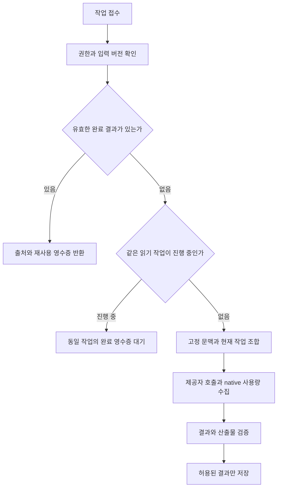

# NewAutoUsage Claude와 Codex 자동 캐시 최적화 설계

2026-10-15 KST. **1차 최적화 대상은 Claude Code와 Claude Agent SDK, Codex app-server**다. 일반 채팅·자동 업무 접수함·오케스트라의 기존 연결 경로를 기준으로 설계한다. 같은 입력에서 유효한 결과를 다시 쓸 수 있으면 AI 호출을 생략하고, 새 판단이 필요하면 고정 문맥을 재사용하기 쉬운 순서로 전달한다. 성공 기준은 **작업 품질과 완료율을 유지하면서 완료 한 건당 전체 소비량을 줄이는 것**이다.

이 계획은 기존 [RAG 최적화 계획](./rag-token-optimization-plan-2026-09-12.md)을 보완한다. 구현 순서는 **두 제공자 계측 → Claude 입력·세션·보존 정책 → Codex 입력·스레드 재개 → 공통 결과 재사용 → 오케스트라 중복 제거 → 개발본 비교 검증**이다. 사용자 선택 모델·추론 수준·역할 배정을 유지한다.

## 1 현재 프로그램에서 재사용할 구조

2026-10-15의 작업 트리를 읽어 확인한 내용이다. 이전 조사 문서의 구현 전 상태와 구분한다.

| 현재 구조                                                           | 확인한 내용                                                                                                         | 설계에 반영할 변경                                                                   |
| ------------------------------------------------------------------- | ------------------------------------------------------------------------------------------------------------------- | ------------------------------------------------------------------------------------ |
| `packages/contracts/src/tokenUsage.ts`                              | 입력·출력·캐시 읽기·캐시 쓰기·추론과 계측 범위를 구분한다                                                           | 기존 원장을 확장해 집계하고 새 원장을 중복으로 만들지 않는다                         |
| `apps/server/src/provider/tokenConsumption.ts`                      | Codex 쓰기는 현재 `null`이다. 0.162.1 스키마와 설치된 protocol 라이브러리에는 선택형 `cacheWriteInputTokens`가 있다 | native 값의 정규화·누계 차분·원장 연결을 P0에서 보완한다. 누락을 0으로 만들지 않는다 |
| `provider/Layers/ClaudeAdapter.ts:4149`                             | 고정 `claude_code` preset+append, `settingSources`, 명시적 `resume`을 사용한다                                      | 이 경로를 유지하며 역할별 캐시 정책을 SDK `settings`에 연결한다                      |
| `provider/Layers/CodexSessionRuntime.ts:464`                        | `thread/resume` 지원과 일부 오류에서 새 `thread/start`로 전환하는 경로가 있다                                       | 같은 작업의 재개를 우선하고 새 스레드 전환과 계측 기준선 변경을 기록한다             |
| `workspacePrompt.ts:214`                                            | 현재 작업을 먼저 넣고 재사용 가능한 프로젝트 문맥을 뒤에 붙인다                                                     | 고정 지침과 안정적인 참조를 앞에, 현재 작업과 변동 자료를 뒤에 배치한다              |
| `workspacePrompt.ts:52`                                             | 지식 순서에 `updatedAt`이 쓰인다                                                                                    | 필수 지침의 우선순위를 보존하며 고정 블록의 순서와 내용 변경을 따로 추적한다         |
| `inputComposition.ts`                                               | 최종 프롬프트 전체의 해시와 문자 수가 있다. native 문맥은 `unknown`이다                                             | 고정 부분·프로젝트 부분·변동 부분별 해시를 추가한다                                  |
| `Layers/WorkspaceAgentExecutor.ts:48`                               | 명시적 지속 세션 키가 없으면 실행 ID를 세션 키로 쓴다                                                               | 같은 논리 작업을 이어가는 경우와 새 격리 세션이 필요한 경우를 분리한다               |
| `WorkspaceTaskInbox.ts:432`                                         | 파일/명령 사전 확인, fingerprint 비교, AI 호출 생략 경로가 있다                                                     | 사전 확인 결과와 성공한 결과 영수증을 연결해 재사용 범위를 넓힌다                    |
| `workspaceContextArtifacts.ts`, `WorkspaceVerificationArtifacts.ts` | 원문과 산출물을 SHA-256으로 확인하는 구조가 있다                                                                    | 캐시 본문·출처·검증 영수증을 연결하고 큰 자료를 반복 전달하지 않는다                 |

일반 채팅은 `ProviderCommandReactor.ts`, 협업은 `WorkspaceAgentExecutor.ts`를 통해 입력을 보낸다. `workspacePrompt.ts`만 바꾸고 모든 AI 호출이 최적화됐다고 판단하지 않는다. CLI가 자체 주입하는 시스템 지침과 도구 정의는 앱에서 관측한 문자열과 별개의 영역이다.

## 2 공개 자료에서 가져올 판단

### 공식 문서

- **OpenAI:** 동일한 앞부분을 재사용하는 캐시이며 모델별 조건이 다르다. 현행 GPT-5.6 이후 문서는 최소 1,024 visible input tokens, `prompt_cache_options.ttl: "30m"`, 명시적 breakpoint와 쓰기 비용을 설명한다. 이 계열에서 `prompt_cache_key`는 캐시 최적화에 필수가 아니므로 모든 모델에 키·24시간 보존 설정을 일괄 적용하지 않는다. 실제 읽기와 쓰기를 함께 측정한다. [Prompt caching](https://developers.openai.com/api/docs/guides/prompt-caching)
- **Anthropic:** `tools → system → messages`가 캐시 대상 문맥을 이룬다. 자동 캐시와 개별 breakpoint가 있고 5분/1시간 보존의 쓰기 비용이 다르다. `input_tokens`, `cache_read_input_tokens`, `cache_creation_input_tokens`의 의미를 구분한다. [Prompt caching](https://platform.claude.com/docs/en/build-with-claude/prompt-caching)
- **xAI:** 고정된 대화·앞부분 유지와 API의 대화 ID/캐시 키를 권장한다. 라우팅·퇴거 때문에 적중은 보장되지 않는다. [Best practices](https://docs.x.ai/developers/advanced-api-usage/prompt-caching/best-practices)
- **Gemini:** 현행 문서는 암묵적 캐시와 모델별 최소 입력을 설명한다. Interactions 및 Gemini 4 Argon 이후에는 명시적 캐시 객체가 지원되지 않으므로 과거 예제를 전 제공자에 적용하지 않는다. [Context caching](https://ai.google.dev/gemini-api/docs/caching)

### GitHub 구현과 재현 보고

| 자료                                                                                                                                                   | 확인한 핵심                                                         | NewAutoUsage 적용 판단                                                                                                       |
| ------------------------------------------------------------------------------------------------------------------------------------------------------ | ------------------------------------------------------------------- | ---------------------------------------------------------------------------------------------------------------------------- |
| [Anthropic 공식 skills의 캐시 지침](https://github.com/anthropics/skills/blob/main/skills/claude-api/shared/prompt-caching.md)                         | 입력의 변화 주기에 따른 배치, 날짜·UUID·도구 순서 등 무효화 요인    | 고정 블록 해시와 순서가 재실행·재접속 후에도 같은지 검사한다                                                                 |
| [Codex app-server 이슈 21796](https://github.com/openai/codex/issues/21796)                                                                            | 외부 오케스트레이터의 새 세션 간 캐시 재사용 불안정 보고            | 독립 세션들이 같은 KV 캐시를 공유한다고 전제하지 않는다. 작성자의 원인 추정은 현행 전체 모델의 확정 동작으로 채택하지 않는다 |
| [Codex breakpoint 이슈 35300](https://github.com/openai/codex/issues/35300)                                                                            | API 기능과 당시 Codex 요청 표현 사이의 차이를 재현한 보고           | 설치된 CLI·프로토콜 버전의 정식 필드 노출을 먼저 확인한다                                                                    |
| [Claude Code 이슈 92524](https://github.com/anthropics/claude-code/issues/92524)                                                                       | 세션별 scratchpad UUID가 고정 부분을 바꾸는 재현 보고               | 앱이 만드는 실행 ID·시각은 영수증에 보관하고 불필요하게 프롬프트 앞에 넣지 않는다                                            |
| [LangGraph CachePolicy](https://github.com/langchain-ai/langgraph/blob/main/libs/langgraph/langgraph/types.py)                                         | 노드별 입력 키 함수와 TTL                                           | 기존 작업 그래프에 노드별 재사용 정책을 추가하는 참고로 삼는다                                                               |
| [LiteLLM 캐시 구현](https://github.com/BerriAI/litellm/blob/main/litellm/caching/caching.py)과 [캐시 문서](https://docs.litellm.ai/docs/proxy/caching) | 요청 해시·namespace·TTL, exact와 semantic의 차이                    | 결과 키와 격리 설계를 참고한다. 초기 구현은 기존 서버·저장 구조 안에서 진행한다                                              |
| [OpenCode 날짜 이동 PR 35310](https://github.com/anomalyco/opencode/pull/35310)                                                                        | 날짜를 변동 메시지로 옮기는 제안. 확인 시점에는 자동 정리로 닫힌 PR | 문제 재현과 설계 아이디어로만 사용한다. 배포된 해결책으로 간주하지 않는다                                                    |

### Reddit 운영 사례

[실행별 캐시 계측 사례](https://www.reddit.com/r/LocalLLM/comments/1vbcwva/i_started_logging_cache_hit_rate_per_agent_run/)는 앞부분·도구 순서 변경을 발견하는 진단 지표로 캐시 사용량을 활용한다. 미보고 제공자를 실패율 100%로 취급하지 않는 점을 가져온다.

[적중률과 비용이 어긋난 사례](https://www.reddit.com/r/AI_Agents/comments/1wdfmid/975_cache_hit_rate_and_it_still_hid_half_our_bill/)에서는 댓글 대조 후 호출당 비용이 오히려 높아졌고, 비용 감소는 실행 빈도 감소에 따른 것이라고 작성자가 정정했다. 이 사례의 숫자를 절감 목표로 삼지 않고 완료량·쓰기 비용·호출 빈도를 함께 비교한다.

[OpenCode 날짜 변경 사례](https://www.reddit.com/r/opencodeCLI/comments/1un7m4w/psa_opencode_invalidates_kv_cache_globally_every/)는 프롬프트 앞부분의 작은 변동을 점검할 근거다. 개인 경험은 우리 프로그램의 성능 보장으로 사용하지 않는다.

## 3 자동 처리 흐름



| 계층                 | 자동 동작                                                      | 줄어드는 대상                                                          |
| -------------------- | -------------------------------------------------------------- | ---------------------------------------------------------------------- |
| 입력 변화 확인       | 파일·원격 버전·지침이 같고 이전 결과가 유효하면 호출 생략      | 전체 AI 호출과 그 입력·출력                                            |
| 제공자 프롬프트 캐시 | 변하지 않는 앞부분을 보존하고 지원되는 캐시 경계를 사용        | 반복 입력 처리 비용과 첫 응답 지연. 문맥 창 점유는 유지                |
| 도구 결과 재사용     | 같은 자료의 읽기·파싱·요약을 재사용하고 필요한 내용만 전달     | 도구 작업과 중복 요약 호출. 본문을 다시 보내면 입력 토큰은 여전히 발생 |
| 실행 중 중복 제거    | 동일한 읽기 전용 요청을 한 번 실행하고 결과를 여러 노드에 전달 | 오케스트라의 중복 조사·분석 호출                                       |

문장이 비슷한 요청을 같은 결과로 간주하는 semantic cache는 코드 수정·검증 판정·명령 실행의 기본 경로에 넣지 않는다. 향후 공개 FAQ 등의 제한된 조회에서 후보 검색으로 평가할 수 있다.

완료 결과의 자동 재사용은 입력 의존성과 읽기 전용 효과가 선언된 업무 양식·자료 분석 노드부터 적용한다. 일반 채팅의 최종 답변이나 새로운 판단·자유 생성을 요구한 요청은 같은 문장을 보냈다는 이유로 이전 답변을 반환하지 않는다. 재사용 가능 여부는 등록된 업무 정책과 검증 가능한 입력으로 판정한다.

## 4 입력을 안정적으로 조합하는 방법

입력은 **공통 작업 규칙 → 역할별 고정 지침 → 프로젝트·폴더의 필수 지침과 안정 자료 → 이어지는 대화 이력 → 최신 자료·현재 작업** 순서로 조합한다. 제공자가 요구하는 message role과 도구 배치 규칙은 어댑터가 처리한다.

1. `inputComposition.ts`에 고정·프로젝트·변동 부분의 revision과 문자 수를 기록한다. 앱이 보낸 부분만 관측했다고 표시하고 native 시스템 문맥 전체의 해시인 것처럼 보여주지 않는다.
2. 순서 의미가 없는 JSON 객체 키와 도구 식별자는 결정적으로 직렬화한다. 대화 순서, 도구 호출과 결과의 짝, 사용자 지침 우선순위는 유지한다.
3. 시각·실행 ID·진행률·다음 작업의 임시 경로는 필요한 경우 최신 부분에 둔다. 결과에 영향을 주지 않는 추적 ID는 영수증에만 저장한다.
4. 필수 지침이 바뀌면 즉시 새 revision을 적용한다. 캐시 유지를 위해 폐기된 지침이나 오래된 사실을 계속 전달하지 않는다.
5. 고정 지침과 관련 RAG를 분리한다. 검색 순위가 바뀌어도 앞의 고정 부분을 매번 다시 쓰지 않는다. 긴 원문은 기존 artifact 참조와 필요한 구간을 사용한다.
6. 캐시 최소 길이를 맞추기 위한 무의미한 내용을 추가하지 않는다. 유용한 안정 자료를 포함하는 선택도 실제 전체 비용과 품질을 비교한 뒤 채택한다.

같은 작업의 후속 턴은 가능한 기존 native 세션을 이어간다. 역할·프로젝트·계정·권한이 다른 에이전트들은 별도 세션을 유지한다. 공통 프로젝트 세션 하나에 모든 에이전트를 몰아넣지 않는다. 압축·새 세션·모델 변경이 발생하면 문맥을 보존한 정상 재시작과 캐시 성과를 별도로 기록한다.

## 5 결과 키와 무효화

AI 분석 결과의 키는 다음 항목을 결정적으로 직렬화한 해시다. 실행 ID나 실제 비밀 키는 포함하지 않는다.

```text
environment + project + permitted knowledge scope + principal scope
+ provider instance/account namespace + model + reasoning/generation parameters
+ compiler/role/directive revisions + relevant tool/schema versions
+ task definition + actual input manifest digest + upstream artifact digests
+ output schema/verifier version + freshness requirements
```

원문 다운로드·파일 파싱 같은 모델 독립 결과는 제공자·모델 항목을 제외한 별도 키를 쓴다. 제공자의 KV 캐시는 서로 공유할 수 없지만, 접근 범위가 같은 에이전트들은 검증된 원문 artifact를 재사용할 수 있다.

| 결과 종류                            | 첫 구현의 유효성 규칙                                                                                     |
| ------------------------------------ | --------------------------------------------------------------------------------------------------------- |
| 파일 파싱·정적 분석                  | 실제 바이트 해시와 파서 버전 일치. 저장 기간은 별도로 제한                                                |
| 특정 Git commit의 자료               | commit·경로·내용 해시 일치. 이동하는 branch의 최신성은 별도 확인                                          |
| GitHub 최신 커밋·이슈                | 지원되는 HTTP validator 또는 새 조회로 현재 버전 확인. 실제 확인 시각과 출처 보존                         |
| 일반 공개 검색 결과                  | 업무별 허용 신선도 적용. 초기 기본 후보는 15분이며 조정 가능한 앱 정책이다                                |
| 사용자가 최신 상태를 요구한 조회     | 현재성 재확인 후에만 재사용                                                                               |
| 코드 검증 결과                       | 소스·untracked 입력·설정·lockfile·명령·도구 버전·환경·산출물이 모두 같은 경우의 해당 영수증만 재사용 후보 |
| 수정·배포·외부 전송 같은 부작용 작업 | 응답 캐시로 실행 여부를 결정하지 않고 기존 실행 영수증·중복 방지·상태 대조 사용                           |

위 15분은 **앱 결과 캐시의 제안값**이며 제공자 KV 보존 시간과 관계없다. 의존 파일 범위를 확정할 수 없거나 허용 범위·입력 해시·출처·검증이 불완전하면 정상 실행한다. 캐시 조회 직후에도 현재 revision을 확인해 입력 변경과의 경합을 막는다.

성공했고 출력 schema와 산출물 검증을 통과한 결과만 등록한다. 실패·취소·부분 결과·실행 결과 불명은 재사용 가능한 완료 결과로 등록하지 않는다. 실패 기록과 재시도 제한은 기존 상태 관리에서 계속 유지한다.

저장은 기존 SQLite와 내용 해시 artifact 구조를 사용한다. 인덱스에는 키·범위·revision·확인/만료 시각·출처·완료 영수증·본문 hash를 둔다. 용량과 보존 기간을 제한하고 오래된 비참조 결과부터 회수한다. 원래 작업 이력·사용량 원장·산출물 증거를 캐시 정리와 함께 삭제하지 않는다.

## 6 오케스트라에서 자동으로 재사용

- **공통 조사 한 번:** 같은 자료를 여러 역할이 필요로 하면 조사 노드 하나의 검증된 artifact를 의존 노드들이 참조한다. 구현·검토 역할의 판단까지 같은 결과로 대체하지 않는다.
- **진행 중 합치기:** 동일한 읽기 키로 실행 중이면 새 AI를 띄우지 않고 기존 완료 영수증을 기다린다. 대기자 한 명의 취소가 다른 대기자의 작업을 취소하지 않게 소유권을 구분한다.
- **변경된 노드부터 갱신:** 입력이나 상위 artifact 해시가 바뀐 노드와 그 의존 노드만 다시 실행한다. 같은 입력이라는 이유로 새 실행의 부작용 완료를 추정하지 않는다.
- **프로필 유지:** 작업 중 역할별 도구 모음을 불필요하게 교체하지 않는다. 실제 권한 변경은 즉시 적용하고 revision을 바꾼다.
- **필요한 결과 전달:** 전체 회의록·검색 덤프 대신 결정, 현재 상태, 필요한 근거와 확장 가능한 원문 참조를 전달한다. 요약 생성 비용과 재조회 비용도 작업 소비량에 포함한다.
- **대기 중 호출 생략:** 상태 확인·파일 변경 확인은 기존 명령 사전 확인으로 처리한다. 캐시를 유지하려는 빈 AI 호출과 주기적인 keep-alive는 기본적으로 만들지 않는다.

처음에는 같은 서버·프로젝트·허용 지식 범위에서만 결과를 공유한다. 공개 자료의 프로젝트 간 공유는 명시적 공용 범위에서만 허용한다. 원격·모바일도 서버의 같은 정책을 사용하며, 본문 전체를 WebSocket으로 반복 전송하지 않는다.

## 7 Claude와 Codex 실행 설계

### 확인한 설치 버전과 계약

PATH의 CLI는 Claude Code **2.1.300**, Codex **0.162.1**이고 프로젝트의 Claude Agent SDK는 **0.3.251**이다. 앱 인스턴스가 다른 실행 파일을 지정할 수 있으므로, 실제 호출 시 해석한 실행 파일·버전·계정 namespace를 최종 기준으로 삼는다. 인증 비밀 값은 진단에 넣지 않는다.

| 항목                       | 읽기 전용 확인 결과                                                               | 구현 결정                                                                                   |
| -------------------------- | --------------------------------------------------------------------------------- | ------------------------------------------------------------------------------------------- |
| Claude SDK `sdk.d.ts:7682` | `promptCacheTtl`과 `subagentPromptCacheTtl`이 각각 `5m`/`1h`를 받는다             | 기존 SDK `settings` 조합에 선택적으로 연결한다                                              |
| Codex 정식 스키마          | `thread/start`, `thread/resume`, `turn/start` 최상위에 전용 캐시 제어 필드가 없다 | 이 RPC에 Responses API의 TTL·breakpoint 옵션을 임의로 추가하지 않는다                       |
| Codex 사용량 스키마        | `tokenUsage.last/total`에 선택형 `cacheWriteInputTokens`가 있다                   | protocol → adapter → consumption → 원장 전 구간에서 값 보존을 확인한다                      |
| 오케스트라 실행기          | 실행 종료 시 `stopSession`을 호출한다                                             | 세션 키 고정만으로 해결했다고 판단하지 않고 native ID·resumeCursor의 저장과 복원을 검증한다 |

Codex 스키마는 설치 CLI의 `generate-json-schema`로 생성했고 실제 AI 추론 호출은 하지 않았다. 스키마와 SDK 타입이 필드를 제공한다는 사실과 해당 계정의 실효 동작은 구분한다. 근거는 `.t3/cache-design-research-20261015/claude-codex/capability-evidence.json`에 보관한다.

### Claude의 입력과 세션

`claude_code` preset과 고정 developer append를 유지하고 역할별 고정 부분을 결정적으로 조합한다. `settingSources`, MCP 도구 식별자·schema, 모델·추론 설정의 변경을 revision으로 추적한다. 갱신되는 인증 header 자체를 고정 프롬프트나 결과 키에 넣지 않는다.

같은 논리 작업의 후속 턴은 기존 streaming query에 넣고, 프로세스 정리나 재시작 후에는 저장한 정확한 `session_id`로 `resume`한다. 역할·작업별로 native 세션을 구분하고 동일 세션의 진행 턴은 직렬화한다. 이는 SDK의 [명시적 세션 재개](https://code.claude.com/docs/en/agent-sdk/sessions)를 이용하는 설계다.

새 세션·resume 시 전체 프로젝트 문맥을 새 메시지로 다시 붙이는 중복을 줄인다. 마지막 전달 revision과 비교해 변경 자료·현재 명령만 추가하고, 처음 필요한 필수 지침은 보존한다. CLI가 이미 읽은 기억과 앱이 넣은 기억이 겹치는지도 전달 출처로 점검한다.

Claude Code는 루트 `CLAUDE.md`를 세션 시작에 읽어 유지하므로 파일 수정만으로 실행 중 세션의 지침이 갱신됐다고 판단하지 않는다. 지침 변경은 지원되는 native 갱신 경로 또는 검증된 인계를 포함한 새 세션으로 반영하고 실제 적용 revision을 기록한다. 권한 회수는 즉시 실행 게이트에 적용한다. [Claude Code 캐시 동작](https://code.claude.com/docs/en/prompt-caching)

### Claude의 캐시 보존 정책

앱 프로필에는 메인/내부 하위 요청 각각 `inherit`, `5m`, `1h`를 둔다. `inherit`는 SDK에 해당 설정을 보내지 않아 기존 사용자·관리 설정과 native 기본값을 유지한다. 선택한 값은 다음 SDK 세션의 `settings.promptCacheTtl`, `settings.subagentPromptCacheTtl`에 전달한다. 환경 설정이 우선할 수 있으므로 요청값·설정 출처·관측된 쓰기 유형을 구분한다.

| 실행 형태                             | 초기 정책                         | 조정 조건                                                    |
| ------------------------------------- | --------------------------------- | ------------------------------------------------------------ |
| Claude 구독의 일반 대화               | `inherit`                         | native 기본값 유지. 사용자 명시 설정 우선                    |
| 짧게 끝나는 API 과금 작업             | `inherit`로 시작, 5분 기준선 측정 | 실제 재개 간격과 쓰기 비용을 비교                            |
| 5~60분 사이에 자주 이어지는 동일 작업 | 지원 확인 후 메인 1시간 정책 비교 | 추가 쓰기 비용보다 재처리 절약이 큰 경우 채택                |
| 장시간 도구를 쓰는 native subagent    | 하위 요청 보존 정책을 별도 평가   | 메인 대화의 정책만 바꿔 하위 작업도 바뀌었다고 판단하지 않음 |
| 하루 몇 번 실행되는 예약 업무         | 결과 재사용·변경 확인 우선        | 실행 간격이 보존 시간보다 길면 빈 호출로 캐시 유지하지 않음  |

**앱의 오케스트라 worker가 별도 SDK query라면 Claude 관점에서는 메인 대화다.** 그 worker가 native subagent를 호출할 때 하위 요청 정책을 사용한다. UI의 역할 이름으로 TTL 종류를 추정하지 않는다. 실제 쓰기 결과에 `usage.cache_creation.ephemeral_5m_input_tokens`/`ephemeral_1h_input_tokens`가 보고되면 선택적 세부 내역으로 수집한다.

Claude Code의 구독 포함 사용량과 API/usage credits는 보존 기본값이 다를 수 있다. 보존 설정·청구 경로를 구분하는 방식은 [Claude Code 공식 캐시 문서](https://code.claude.com/docs/en/prompt-caching)를 따르고, 설정 필드의 존재는 설치 SDK 타입으로 확인했다. 인스턴스별 실효 동작은 개발본의 정상 업무 호출에서 검증한다.

### Codex의 입력과 스레드

같은 논리 작업은 저장한 native `thread.id`로 이어간다. 재접속은 `thread/resume`, 후속 요청은 같은 ID의 `turn/start`를 사용한다. 이는 [app-server의 정상 세션 경로](https://learn.chatgpt.com/docs/app-server)이며 적중 여부는 실제 사용량으로 확인한다.

고정 developer 지침·도구·sandbox/cwd 설정을 불필요하게 재구성하지 않고 작업별 변경을 새 입력에 추가한다. Codex 자체의 base instructions를 캐시 때문에 교체하지 않는다. 입력을 앞에서 다시 쓰는 대신 변경을 뒤에 추가하는 원칙은 [OpenAI의 Codex 캐시 사례](https://developers.openai.com/cookbook/examples/prompt_caching_201)와 정합한다.

`openCodexThread`가 복구 가능한 오류로 새 스레드에 전환하면 `resume-fallback`과 native ID 변경을 기록한다. 이전 대화의 필요한 결정·미완료·근거를 인계하고 기존 thread 누계를 새 작업 사용량으로 다시 청구하지 않는다. 실패 원인이 인증·권한·한도라면 이를 캐시 문제로 분류하지 않는다.

P0에서 `cacheWriteInputTokens`를 nullable인 정규화 값으로 연결한다. `last`와 `total`을 합산하지 않고 기존 누계 차분 원칙을 유지한다. `input >= cacheRead + cacheWrite`와 `total = input + output`을 검증하며 필드가 없으면 `unknown`으로 남긴다. 재개 후 기준선, 새 스레드, 카운터 회귀, 취소와 늦게 도착한 이벤트를 구분한다.

Codex에는 실제 지원이 확인되지 않은 TTL 조절 UI를 만들지 않고 `native 자동 관리`와 읽기·쓰기 관측값을 보여준다. 범용 `config`가 존재한다는 사실만으로 임의의 API 캐시 옵션을 지원한다고 추정하지 않는다. 설치 프로토콜에 정식 지원이 추가될 때 capability와 집중 테스트를 함께 갱신한다.

### Claude와 Codex가 함께 일할 때

두 제공자는 각자의 대화와 KV 캐시를 유지한다. 역할별 선택 모델을 고정하고 같은 노드의 수정을 같은 제공자·native 세션에서 이어간다. 새 독립 검토가 필요하면 별도 세션을 사용한다.

공유 대상은 **입력 원문 artifact, 파일/commit hash, 검증된 조사 결과, 완료 기준과 산출물 영수증**이다. Claude→Codex와 Codex→Claude 인계에는 목표·제약·완료/미완료·변경 파일·검증·필요 근거를 보내고 전체 native transcript를 복제하지 않는다. 구조화된 근거는 권한과 최신성 확인 후 재사용하며 서로의 내부 추론·서명은 복사하지 않는다.

각 제공자·프로젝트·작업·역할에 대응하는 native ID와 마지막 전달 revision을 기존 세션 저장 구조에 연결한다. 작업이 끝나면 프로세스를 정리할 수 있어야 하며, 서버 측 캐시 유지를 위해 빈 query나 상주 agent를 만들지 않는다. 새 작업·다른 권한 범위에는 이전 세션의 사적 대화를 섞지 않는다.

Grok·Gemini·Cursor·OpenCode는 공통 결과 정책과 기존 동작의 호환 범위로 유지한다. 1차 rollout의 제공자별 기능과 성과 판정은 Claude·Codex에서 수행한다.

## 8 사용량과 화면

기존 `TokenCounts.input`은 캐시를 포함한 전체 입력이다. 읽기 R, 쓰기 W, 전체 입력 I가 모두 보고되면 일반 입력은 `I − R − W`로 계산한다. 추론은 출력의 일부이므로 다시 합산하지 않는다.

```text
캐시 입력 비율 = ΣR / ΣI                  # 해당 값이 보고된 요청 집합
읽기 관측 요청 비율 = R > 0인 요청 / 읽기 계측 가능한 요청
앱 재사용 = 실제 생략한 AI 호출 수          # 이전 호출의 토큰을 새 소비량에 재합산하지 않음
작업 소비량 = 모든 실제 입력 + 모든 실제 출력
완료당 비용 = 비교 실험군의 전체 실제/추정 비용 / 같은 완료 기준 통과 수
```

API 가격과 입력 구분이 모두 확인될 때만 일반 입력·읽기·쓰기·출력 요율을 적용한다. 가격 확인일과 추정 표시를 붙인다. 쓰기가 미보고이면 임의로 0을 채워 금액을 계산하지 않는다. 구독 한도 차감은 별도의 실제 관측 없이 API 비용으로 환산하지 않는다.

부분 계측은 관측된 하한과 누락 범위를 표시하며 전체 소비량으로 비교하지 않는다. P1과 P2는 비캐시 입력·입력 비용·응답 지연을, P3와 P4는 생략한 호출과 실제 입력·출력 감소를 주로 검증한다. 총토큰 감소, 캐시 처리 비용 감소, 구독 한도 절약을 같은 성과로 합치지 않는다.

예를 들어 입력 10,000토큰 중 8,000이 읽기이고 읽기 요율을 일반 입력의 10%라고 **가정**하면, 쓰기 없는 그 요청의 입력 비용은 일반 입력 2,000 + 읽기 환산 800 = 2,800단위다. 입력 토큰과 문맥 점유는 여전히 10,000이다. 최초 쓰기·출력·요약·실패 호출까지 포함한 전체 비교로 실제 채택을 결정한다.

표시는 기존 토큰 상세 화면에 연결한다. 사용자가 알아야 할 상태는 **제공자 캐시 읽음, 이전 결과 재사용, 입력 변경으로 재실행, 사용량 미보고**다. 세부 화면에서 알려진 무효화 사유와 출처 확인 시각을 제공한다. `0`과 `unknown`을 구분하고, 고정 부분이 같아도 적중하지 않은 경우 native 근거 없이 TTL이나 서버 라우팅을 원인으로 확정하지 않는다. [OpenAI 진단 기능](https://developers.openai.com/api/docs/guides/prompt-caching/diagnostics)은 지원되는 API 경로에서만 사용한다.

작업별 강제 새 실행, 결과 캐시 끄기, 특정 결과 무효화와 현재 설정 확인을 제공한다. 설정·제어센터·명령 팔레트에서 연결하고 웹·데스크톱·모바일에 같은 상태를 전달한다.

## 9 구현 순서와 완료 기준

| 순서              | 개발본 변경                                                         | 통과 조건                                                                       |
| ----------------- | ------------------------------------------------------------------- | ------------------------------------------------------------------------------- |
| P0 두 제공자 계측 | 고정 부분별 revision, Codex 쓰기 수집, Claude 보존별 쓰기·계측 범위 | 중복·누락·0/unknown을 구분하고 두 제공자의 입력 합계를 일관되게 정규화          |
| P1 Claude 최적화  | SDK 고정 입력, 같은 작업의 query/resume, 메인/하위 보존 정책        | 최신 지침 적용, 정확한 세션 복원, 실효 설정과 실제 읽기·쓰기 확인               |
| P2 Codex 최적화   | 같은 thread 유지/resume, 새 thread fallback 추적, 누계 기준선       | 재개와 새 실행을 구분하고 고정 입력·기존 작업 사용량을 중복 전송·귀속하지 않음  |
| P3 읽기 결과      | 두 제공자가 공유할 접수함 사전 확인과 artifact 인덱스               | 같은 유효 입력은 새 호출 없음. 입력·권한·기한 변경은 재실행                     |
| P4 오케스트라     | 읽기 요청 합치기, 공통 조사 결과, 양방향 인계, 의존 노드 갱신       | 같은 키 병렬 요청은 실제 호출 한 번. 다른 역할 판단 보존, 취소·재시작 경합 정상 |
| P5 비교와 교체    | 격리된 개발본 파일럿, 빌드, 통합 검증                               | 품질·완료율 유지와 완료당 소비량 개선 확인 후 운영 반영                         |

집중 테스트는 입력 조합·지침 변경·캐시 키의 의미 있는 변경·범위 격리·TTL·중복 요청·취소·재시작·손상된 artifact·계측 중복을 다룬다. 부작용 명령, 최신성 불명, 실패한 산출물이 재사용되지 않는 사례를 반드시 포함한다. 저장소 전체 검사를 반복하지 않는다.

파일럿은 같은 모델·추론·CLI 버전·코드/완료 기준으로 고정한다. 일반 후속 대화, 같은 파일 재분석, 다른 파일 변경, GitHub 변화 있음/없음, 병렬 공통 조사, TTL 경과 후 재개, 지침·권한 변경, 실패 복구를 포함한다. 실행 순서를 섞고 각 조건을 최소 3회 반복하되, 이를 통계적 보장으로 확대하지 않는다. 새 세션을 실제 cold cache라고 부르지 않고 관측된 읽기·쓰기를 기록한다.

| 비교 축               | Claude                                                  | Codex                                               |
| --------------------- | ------------------------------------------------------- | --------------------------------------------------- |
| 후속 턴               | 기존 query와 정확한 session resume                      | 같은 thread turn과 thread resume                    |
| 프로세스 정리 후 재개 | session_id·cursor·고정 지침 복원                        | native thread ID·누계 기준선 복원                   |
| 보존 시간             | 지원 계정에서 inherit/5m/1h 비교, 메인/하위 구분        | 경과 시간별 실제 읽기·쓰기 관측, 임의 TTL 제어 없음 |
| 무효화                | 지침·도구·설정 변경과 실효 적용 확인                    | developer 지침·도구·native ID 변경 확인             |
| 계측 회귀             | result 중복, native child 계측 범위, 선택적 보존별 쓰기 | 선택적 쓰기 누락, 누계 중복·회귀, resume fallback   |
| 교차 제공자           | Codex의 검증된 자료 재사용 후 독립 판단                 | Claude의 검증된 자료 재사용 후 독립 판단            |

초기 채택 조건은 필수 제약 위반·잘못된 결과 재사용 0건, 같은 완료 기준의 품질 유지, 실패·요약·하위 작업까지 포함한 계층별 목표 지표의 개선이다. 전체 완료당 비용과 총토큰도 함께 제시한다. 수치 목표는 P0 기준선 후 정한다. 캐시가 불가능해도 기존 정상 실행을 완료할 수 있어야 한다.

사용자 원칙에 따라 분리된 개발본에서 먼저 구현·검증·빌드한다. 운영 교체 직전의 산출물 검증, 데이터 보존 확인, 서버·데스크톱의 실제 상태 확인은 새로 수행한다. 검증 결과 재사용으로 이 최종 안정성 확인을 생략하지 않는다. 문제가 생기면 새 기능 설정을 꺼 기존 실행 경로로 돌아가며 원장과 원본 증거를 유지한다.

## 10 조사 범위와 기록

Grok CLI `1.0.46 (2765805b9442)`를 화면을 띄우지 않는 조사 세션으로 실행했다. 이번 세션의 native X 도구 검색은 결과가 없었고 직접 호출은 실패해, **수집에 성공한 X 게시물은 0건**이다. 프로세스 종료 코드 0과 `stopReason: cancelled`를 구분했다. 도구의 `User cancelled` 문자열만으로 사용자가 직접 취소했다고 판단하지 않는다.

계획의 외부 근거는 위에서 직접 열람한 공식 문서와 GitHub·Reddit 자료다. X 본문을 읽었다고 주장하거나 Grok의 미완성 응답을 기술 근거로 사용하지 않는다. 조사 세션의 호출 metadata와 공개 응답은 `.t3/cache-design-research-20261015/`에 보관한다. 내부 thought나 signature는 계획서와 재사용 지식에 포함하지 않는다.

이 단계의 산출물은 설계와 수집 기록이다. 구현 결과와 NewAutoUsage의 실제 절감률은 P0~P5의 영수증으로 별도 기록한다.
