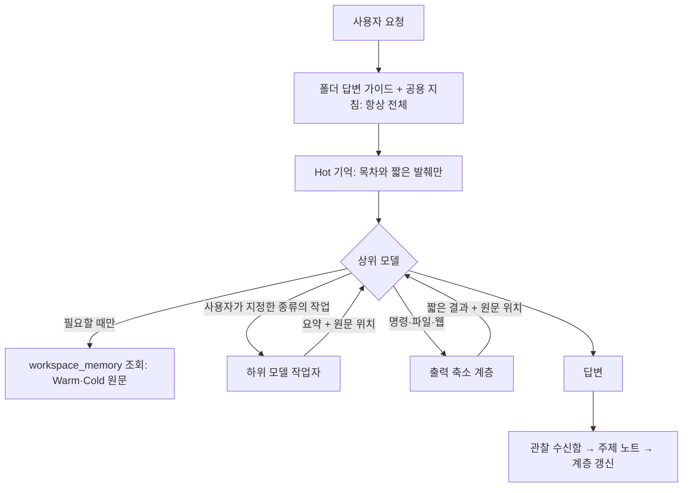

# 장기기억·토큰 최적화 설계 도안 (2026-11-10)

상태: 1단계(제공자 지원 확인) 완료, 2단계(C 폴더 답변 가이드) 서버 부분 구현·검증 완료(2026-11-11). 화면 입력란은 남음.
적용 범위: **Claude와 Codex**. Grok·Gemini와 그 밖의 제공자는 이번 범위에서 제외한다(사용자 결정, 2026-11-10).
참고한 외부 저장소: [context-mode](https://github.com/mksglu/context-mode), [dual-brain](https://github.com/sleeplesshan/dual-brain), [agent_skills](https://github.com/janestreet/agent_skills)

## 1. 목표

같은 구독 한도로 더 많은 작업을 하도록, AI마다 요청 1건에 들어가는 토큰을 줄인다. 장기기억은 유지하되 매 요청에 싣는 양을 줄이고 필요한 것만 꺼내 읽게 한다.

판정은 기존 **작업 토큰 사용량** 화면의 실제 보고값으로 한다. 같은 모델·같은 완료 기준에서 작업당 총 토큰(원문 재조회 포함)이 줄어야 개선으로 본다. 입력 글자 수 감소만으로는 개선으로 보지 않는다.

## 2. 현재 구조에서 확인한 것

| 영역              | 현재 동작                                                                                     | 근거 문서                                           |
| ----------------- | --------------------------------------------------------------------------------------------- | --------------------------------------------------- |
| 장기기억 저장     | SQLite 원문 보존, `memory-v2`의 관찰 수신함 → 주제 노트 → `MEMORY.md`(범위당 8 KiB·주제 64개) | internals/memory-v2.md                              |
| 기억 조회         | 모든 제공자 공용 MCP 도구 `workspace_memory`(search·read·history·remember·dream·forget)       | user/memory-and-history.md                          |
| 매 요청 자동 주입 | 최근 발언 최대 30개·약 16,000자, 기억 발췌 약 14 KiB, 프로젝트 문맥 기본 예산 60,000자        | 위 두 문서, github-token-and-orchestra-optimization |
| 기억 범위         | 공용 / 프로젝트 / 특정 폴더. 사용자 지침은 예산과 무관하게 유지                               | user/workspace-orchestration.md                     |
| 모델 배정         | 오케스트라에서 역할별 계정·모델과 지휘 AI를 사용자가 선택                                     | 같은 문서                                           |
| 스킬              | `SKILL.md` 형식, `.agents/skills`와 `.claude/skills`를 읽음. 설치는 제공자·계정·프로젝트 단위 | user/agent-platform-upgrade.md                      |
| 사용량            | 요청·단계·시도별 집계, 목표·일일 예산                                                         | user/token-usage.md                                 |

남아 있는 빈 곳은 네 가지다.

1. 자동 주입량이 요청 내용과 무관하게 큰 고정 상한으로 잡혀 있다.
2. 기억에 사용 빈도 개념이 없다. 정리된 영구 노트는 오래돼도 같은 비중으로 후보가 된다.
3. 일반 단일 채팅에는 상위 모델이 하위 모델로 일을 넘기는 경로가 없다.
4. 도구 출력(명령 결과, 파일 읽기, 웹 수집)은 줄이지 않고 그대로 모델에 들어간다. 10월 15일자 문서의 "명령 출력 축소" 과제가 이 부분이다.

## 3. 설계 원칙

- 원문은 지우지 않는다. 줄이는 것은 모델에 싣는 양이다.
- 기본은 "목차만 싣고 본문은 조회"다. 필수 사용자 지침만 항상 전체를 싣는다.
- 요약용 모델을 몰래 호출하지 않는다. 하위 모델을 쓰는 곳은 사용자가 지정한 곳뿐이다.
- 모든 항목은 프로젝트별로 켜고 끌 수 있고, 끄면 현재 동작으로 돌아간다.
- 제공자가 지원하지 않는 기능은 조용히 대체하지 않고 미지원으로 표시한다.

## 4. 요청 1건의 흐름

앞부분(가이드·지침·Hot 목차)은 요청마다 같은 순서로 유지해 캐시 재사용을 돕는다.

## 5. 설계 항목

### A. 기억 계층화 (dual-brain의 Hot·Warm·Cold 차용)

주제 노트마다 `참조 횟수`, `마지막 참조 시각`, `마지막 검증 시각`을 기록한다. 새 표 하나를 추가하는 방식이며 기존 노트 파일은 바꾸지 않는다.

| 계층 | 조건(초안)                           | 요청에 싣는 것                  |
| ---- | ------------------------------------ | ------------------------------- |
| Hot  | 최근 자주 참조됨, 또는 사용자가 고정 | 목차 한 줄 + 짧은 발췌          |
| Warm | 가끔 참조됨                          | 목차 한 줄만                    |
| Cold | 오래 참조 없음                       | 싣지 않음. 검색으로만 조회      |
| 보관 | 사용자가 forget 또는 보관            | 검색에서도 제외(현재 동작 유지) |

승격·강등은 `dream` 실행 때 규칙으로 계산한다. 모델을 호출하지 않는다. 사용자 발언과 명시적 정정은 계층과 무관하게 우선한다.

### B. 자동 주입 축소

- 최근 발언: 고정 30개 대신 "바로 전 사용자 발언 + 현재 요청과 겹치는 발언"을 우선하고 나머지는 ID 목록만 준다. 상한은 사용자 설정값으로 남긴다.
- 기억 발췌: Hot만 발췌를 싣고 Warm은 제목만 싣는다.
- 프로젝트 문맥: 역할별 예산을 둔다. 지휘자는 넓게, 작업자는 배정받은 작업과 직접 의존 결과만 받는다.
- 문맥 미리보기에 "고정 주입 / 선택 주입 / 조회로 미룸" 세 칸의 추정 토큰을 표시한다.

### C. 폴더별 답변 가이드

기존 폴더 범위 지침(`directive`)을 그대로 쓴다. 새 저장 구조는 만들지 않는다.

- 폴더를 열면 보이는 **답변 가이드** 입력란을 추가한다. 저장하면 그 폴더와 하위 경로의 모든 채팅·오케스트라에 적용된다.
- 적용 순서: 현재 사용자 요청 > 폴더 가이드 > 프로젝트 지침 > 공용 지침.
- 일반 채팅에서는 "프로젝트 기억 연결" 설정과 무관하게 가이드는 항상 싣는다. 가이드는 기억이 아니라 지침이기 때문이다.
- 가이드 길이를 화면에 토큰 추정치로 보여 준다. 매 요청에 실리는 고정 비용이라는 점을 표시한다.

### D. 하위 모델 위임 (사용자가 선택)

설정 → 제공자마다 **위임 모델** 칸을 둔다. 비워 두면 위임하지 않는다.

| 위임 대상(체크박스) | 내용                                      |
| ------------------- | ----------------------------------------- |
| 탐색                | 파일 찾기, 호출 지점 목록, 로그 훑기      |
| 요약·추출           | 긴 문서·출력에서 필요한 부분 뽑기         |
| 반복 구현           | 정해진 형식의 다수 파일 수정, 테스트 작성 |
| 검증 실행           | 명령 실행과 결과 정리                     |

- Claude 일반 채팅: 내장 하위 에이전트의 모델을 사용자가 고른 값으로 지정한다. 지금은 제공자 설정의 환경 변수 칸에 `CLAUDE_CODE_SUBAGENT_MODEL`을 직접 적어야 하므로, 이것을 모델 선택 칸으로 바꾼다.
- Codex 일반 채팅: Codex는 하위 에이전트 전체에 적용되는 기본 모델 설정이 없고, `.codex/agents/<이름>.toml`의 `model` 키로 에이전트별 모델을 정한다([Codex Subagents 문서](https://developers.openai.com/codex/subagents)). 따라서 위임 대상별 에이전트 정의 파일을 프로그램이 생성·갱신하고, 사용자가 고른 모델을 그 파일의 `model`에 적는다. 프로젝트 범위(`.codex/agents/`)에만 쓰고 사용자 전역 설정은 건드리지 않는다.
- 오케스트라: 현재의 참가자 선택을 그대로 쓰고, 지휘자 배정 규칙에 "작업 종류 → 사용자가 고른 하위 모델 우선"만 추가한다.
- 하위 모델의 결과는 요약과 원문 위치만 상위 모델에 돌려준다. 전체 출력은 원문 파일로 보관한다.
- 안전 거절이나 실패를 이유로 사용자가 고르지 않은 모델로 바꾸지 않는다(현재 정책 유지).
- 사용량 화면에 상위·하위 모델별 토큰을 나눠 표시한다.

### E. 모든 AI 공용 스킬

- 공용 원본 저장소를 하나 둔다(환경 범위). 여기에 넣은 `SKILL.md` 폴더가 기준이다.
- 제공자가 네이티브 스킬을 지원하면 그 제공자 경로에 연결하고, 지원하지 않으면 본문을 지침으로 전달한다. 계약의 `SkillBinding.mode`(`native` / `instructions`)가 이미 이 구분을 갖고 있다.
- 목록에는 이름과 한 줄 설명만 싣고 본문은 선택됐을 때만 읽는다. 스킬 수가 늘어도 고정 비용이 커지지 않게 한다.
- 제공자별 지원 상태를 표로 보여 준다. 지원하지 않는 옵션은 미지원으로 표시한다.
- agent_skills의 `socratic-tutor`와 dual-brain을 첫 시험 표본으로 쓴다. dual-brain은 하위 에이전트 두 개를 추가로 돌리므로 D의 위임 모델을 지정했을 때만 권장으로 표시한다.

### F. 도구 출력 축소 (context-mode)

- context-mode를 MCP 서버로 프로젝트 단위 등록한다. 전역 훅이나 사용자 지침 파일을 일괄 수정하는 설치는 하지 않는다.
- 먼저 Claude에서 시범 적용한다. 훅 전체 기능이 Claude Code 기준이기 때문이다. Codex는 MCP 도구만 붙여 따로 측정한다.
- 필요 조건: Node.js 22.5 이상 또는 Bun. 현재 런타임과 맞는지 먼저 확인한다.
- 실패 진단, 종료 코드, 한글·공백 인자가 보존되는지 CMD 기준으로 확인한다. PowerShell은 쓰지 않는다.
- 효과가 없거나 원문 재조회가 늘어 총 토큰이 늘면 해당 제공자에서는 끈다.

### G. AI별 적용 범위 (1단계 확인 결과)

| 항목                    | Claude                                 | Codex                                                                                    |
| ----------------------- | -------------------------------------- | ---------------------------------------------------------------------------------------- |
| 기억 조회 도구          | 관리 MCP로 연결됨                      | 관리 MCP로 연결됨(`mcp_servers.t3-code`)                                                 |
| 사용자 추가 MCP(F 항목) | 등록 대상에 포함                       | 등록 대상에 포함                                                                         |
| 스킬                    | 네이티브, 확장 관리 지원               | 턴 시작 시 스킬 전달, 확장 관리 지원                                                     |
| 내장 하위 에이전트      | 있음. 활동과 토큰이 부모 작업에 귀속   | 있음(multi-agent v2). 자식 스레드 토큰 이벤트를 수신하나 코드 주석상 일부는 검증 진행 중 |
| 하위 에이전트 모델 지정 | 환경 변수 `CLAUDE_CODE_SUBAGENT_MODEL` | 에이전트 정의 파일의 `model` 키                                                          |
| 하위 에이전트 캐시      | 유지 시간 설정 있음                    | 앱에서 지정하지 않음                                                                     |
| 사용량 보고             | 보고됨                                 | 보고됨. 재개 시 누적값 중복 방지 처리 있음                                               |

확인 근거: `apps/server/src/provider/Layers/CodexAdapter.ts`, `CodexSessionRuntime.ts`, `ClaudeAdapter.ts`, `mcp/ManagedMcpTools.ts`, `extensions/ExtensionManager.ts`, `packages/contracts/src/settings.ts`. 코드를 읽어 확인한 것이며 실행으로 검증하지는 않았다.

## 6. 개발 순서와 완료 조건

| 순서 | 작업               | 완료 조건                                                              |
| ---- | ------------------ | ---------------------------------------------------------------------- |
| 0    | 기준선 측정        | 대표 작업 5~10개의 현재 토큰을 제공자별로 기록                         |
| 1    | G 표 확정          | 코드 확인 완료(2026-11-10). 실행 확인은 0번과 함께 진행                |
| 2    | C 폴더 답변 가이드 | 서버 완료(2026-11-11, 10절). 남은 것: 웹·데스크톱·모바일의 전용 입력란 |
| 3    | B 자동 주입 축소   | 필수 지침 보존, 기준선 대비 입력 토큰 감소, 답변 품질 유지             |
| 4    | A 기억 계층화      | 참조 기록 누락 없음, 강등된 기억도 검색으로 조회됨, forget 유지        |
| 5    | D 하위 모델 위임   | 사용자가 고른 모델만 사용, 상위·하위 토큰 분리 표시                    |
| 6    | E 공용 스킬        | 한 번 설치로 지원 제공자 전부에서 호출, 미지원 표시                    |
| 7    | F 출력 축소 시범   | Claude에서 총 토큰 개선 확인 후 다른 제공자로 확대                     |

각 단계는 격리 작업공간에서 검증한 뒤 운영 프로그램과 교체한다(기존 지침 유지).

## 7. 하위 에이전트를 이용한 개발 방식

상위 모델 하나가 설계와 통합을 맡고, 나머지는 사용자가 고른 하위 모델에 맡긴다. 이 방식 자체가 D 항목의 시험이 된다.

| 역할      | 모델 등급              | 맡는 일                                                          | 돌려주는 것                         |
| --------- | ---------------------- | ---------------------------------------------------------------- | ----------------------------------- |
| 지휘      | 상위                   | 계약(`packages/contracts`) 변경 설계, 작업 분할, 통합, 최종 검토 | 작업 지시서, 병합 판단              |
| 탐색      | 하위                   | 관련 파일·호출 지점·기존 테스트 찾기                             | 경로와 줄 번호 목록(본문 덤프 금지) |
| 구현      | 중간                   | 서버 로직, 마이그레이션                                          | diff와 변경 요약                    |
| 반복 반영 | 하위                   | 웹·데스크톱·모바일 화면 반영, 문구, 문서 갱신                    | diff                                |
| 테스트    | 하위                   | 단위 테스트 작성과 실행                                          | 통과·실패 목록, 실패 원문 위치      |
| 독립 검증 | 중간(구현과 다른 세션) | 구현 과정을 보지 않은 상태에서 완료 조건 대조                    | 조건별 통과 여부와 근거             |

작업 지시서 규칙:

- 지시서 하나에 목표, 읽을 파일 목록, 바꿔도 되는 범위, 완료 조건, 결과 형식을 적는다.
- 하위 에이전트는 결과를 요약과 파일 위치로만 돌려준다. 긴 출력은 파일로 남긴다.
- 서로 의존하지 않는 작업(예: 2번의 서버와 화면)은 병렬로 돌리고 worktree로 격리한다.
- 계약 변경은 지휘 모델만 한다. 하위 에이전트가 계약을 바꿔야 하면 멈추고 보고한다.
- 단계마다 상위·하위 토큰을 기록해 "전부 상위 모델로 했을 때"의 추정과 비교한다.

실행 위치: 빌드와 테스트는 사용자 PC에서 돌아야 한다. AutoUsage의 오케스트라(지휘 AI + 참가자 모델 선택)로 위 역할을 그대로 배치하는 것이 가장 직접적이다.

## 8. 확인하지 못한 것

- 10월 15일자 최적화 문서의 8개 과제가 각각 어디까지 구현됐는지 코드로 대조하지 않았다.
- 설치된 Codex CLI 버전에서 `.codex/agents/` 정의 파일과 `model` 키가 실제로 적용되는지 실행으로 확인하지 않았다.
- Codex 자식 에이전트 토큰이 사용량 화면에 빠짐없이 합산되는지 확인하지 않았다.
- context-mode README는 앞부분 약 70%만 읽었다.
- 5절의 수치 조건(계층 기준, 발언 상한)은 초안이며 기준선 측정 뒤에 정한다.

## 9. 바로 실행할 작업 지시서

빌드와 테스트가 필요하므로 사용자 PC에서 실행한다. 오케스트라에 지휘 AI 1개와 하위 모델 참가자를 넣고 아래를 그대로 요청으로 쓴다.

### 지시서 0: 기준선 측정 (하위 모델)

- 목표: Claude와 Codex 각각에서 대표 작업의 현재 토큰을 기록한다.
- 방법: 코드 수정 없는 동일한 요청 5개(짧은 질문, 파일 탐색, 긴 문서 요약, 작은 수정, 이어서 진행)를 각 제공자에 새 대화로 보내고, 작업 토큰 사용량의 입력·출력·캐시 읽기·캐시 쓰기를 표로 남긴다.
- 함께 확인: Codex에서 하위 에이전트를 한 번 쓰게 한 뒤 자식 토큰이 합계에 들어오는지 본다.
- 결과: `docs/internals/`의 이 문서 10절에 표로 추가한다. 코드와 설정은 바꾸지 않는다.

### 지시서 1: 폴더별 답변 가이드 (C 항목)

- 탐색(하위 모델): 폴더 범위 지침이 저장되는 경로(`workspaceKnowledgeScope.ts`, `workspacePrompt.ts`, `WorkspaceMemory.ts`)와 일반 채팅에서 지침이 조립되는 지점, 웹·모바일의 기억 범위 선택 화면 위치를 경로와 줄 번호로 보고한다.
- 설계(지휘 모델): 새 저장 구조 없이 `scope: "folder"`, `kind: "directive"` 항목으로 가이드를 저장하는 계약 변경안을 정한다. 계약 파일은 지휘 모델만 수정한다.
- 구현(중간 모델): 일반 채팅에서 "프로젝트 기억 연결" 설정과 무관하게 현재 작업 폴더의 가이드를 싣는다. 적용 순서는 현재 요청 > 폴더 가이드 > 프로젝트 지침 > 공용 지침.
- 화면(하위 모델): 폴더별 답변 가이드 입력란과 토큰 추정치 표시를 웹·데스크톱·모바일에 반영한다.
- 테스트(하위 모델): 해당 폴더와 하위 경로 적용, 이름이 비슷한 형제 폴더 미적용, 가이드가 없을 때 기존 동작 유지, Claude와 Codex 양쪽 입력에 포함되는지.
- 독립 검증(구현과 다른 세션): 위 완료 조건을 근거와 함께 대조한다.
- 제한: 격리 작업공간에서 검증한 뒤에만 운영 프로그램과 교체한다. PowerShell을 쓰지 않는다. 임시 파일은 끝나면 지운다.

## 10. 진행 기록

### 2026-11-11: 폴더 답변 가이드(서버)와 오케스트라 지침 중복 제거

검증 환경: 이 PC의 소스를 클라우드 작업공간에 복사해 타입검사·테스트를 실행한 뒤 변경 파일 3개만 되돌려 썼다. 운영 프로그램은 재시작하지 않았다.

변경 파일:

- `apps/server/src/orchestration/WorkspaceMemory.ts`
- `apps/server/src/orchestration/WorkspaceMemory.test.ts`
- `apps/server/src/orchestration/Layers/WorkspaceCollaborationReactor.ts`

동작 변경:

1. 폴더 범위 사용자 지침(`kind: directive`, `scope: folder`)을 "폴더 답변 가이드"로 취급해, 현재 메시지에 기록된 작업 폴더 또는 그 하위 폴더에 해당하면 `<t3_user_directives>`에 넣는다. 자동 대화 기억 설정이 꺼져 있어도 들어간다. 이전에는 자동 대화 기억이 켜진 경우의 문맥 조립에서만 들어갔다.
2. 이름이 비슷한 형제 폴더(`apps/web`과 `apps/web-extra`)에는 적용하지 않는다. 프로젝트 루트 작업에는 폴더 가이드를 넣지 않는다.
3. 공용·프로젝트 지침을 앞에, 폴더 가이드를 뒤에 둔다. 폴더가 바뀌어도 앞부분이 같아 캐시 재사용에 유리하다.
4. 오케스트라 노드 요청은 이미 조립된 프로젝트 문맥에 들어간 지침 본문을 필수 지침 블록에서 다시 붙이지 않는다. 그동안 공용·프로젝트 지침이 노드마다 두 번씩 들어가고 있었다. 지침 본문이 그대로 포함된 경우에만 생략하므로, 잘렸거나 일부만 들어간 경우에는 계속 붙인다.

계약(`packages/contracts`) 변경은 없다. `WorkspaceMemory.context`에 선택 인자 `directiveOptions`(`folderPaths`, `presentIn`)를 추가했다.

검증 결과:

| 항목                                                                      | 결과                            |
| ------------------------------------------------------------------------- | ------------------------------- |
| `WorkspaceMemory.test.ts`                                                 | 34건 통과(신규 2건 포함)        |
| `workspacePrompt`·`workspacePromptRelevant`·협업 회의 테스트              | 모두 통과(위와 합계 176건)      |
| 서버 타입검사                                                             | 오류 15건, 변경 전과 동일 목록  |
| `ProviderCommandReactor.test.ts`, `WorkspaceCollaborationReactor.test.ts` | 실패 120건, 변경 전과 동일 목록 |

기존 실패의 원인(이번 변경과 무관):

- `ProviderCommandReactor.test.ts` 118건: 테스트 레이어에 `SqlClient`가 빠져 있다. 타입검사 오류 15건도 같은 원인이다.
- `WorkspaceCollaborationReactor.test.ts` 2건: 작업 그래프 프롬프트의 예전 문구를 기대한다.

남은 일:

- 폴더 답변 가이드 전용 입력란(웹·데스크톱·모바일). 지금은 기존 지식 저장 화면에서 종류를 "지속 사용자 지침", 범위를 "특정 폴더"로 저장하면 같은 효과가 난다.
- 위 기존 테스트 실패 정리.
- 운영 프로그램 재시작 후 실제 대화에서 가이드가 들어가는지 확인.

### 2026-11-27: 토큰 기준선 측정(1부) · 공급망 감사(2부) · 작업자 낭비 5종 수정(3부) · 전후 비교(4부)

#### 1) 토큰 기준선 측정 (읽기 전용, `E:\NewAutoUsage\userdata\state.sqlite`)

원본: `projection_token_usage_requests` 6,175건 · `projection_token_usage_samples` 6,736건. CSV·상세 요약은 `D:\__NewAutoUsage\.t3\exports\token-usage-2026-11-27\`에 저장.

| 구간 (KST)                  | 구분         | 요청 수 | 미보고(%) | 부분집계(%) | 요청당 중앙값 | 요청당 평균 | 캐시제외 입력(평균) | 캐시읽기(%) | 출력(평균) | 스레드 수 |        스레드당 중앙/평균 |
| --------------------------- | ------------ | ------: | --------: | ----------: | ------------: | ----------: | ------------------: | ----------: | ---------: | --------: | ------------------------: |
| ① 11-22 16:45 이전          | `main_chat`  |   4,904 |    32.34% |       5.12% |     2,182,712 |   6,224,688 |             142,911 |      97.70% |     20,238 |        29 |  17,969,816 / 712,190,140 |
| ① 11-22 16:45 이전          | `sub_worker` |     218 |    28.44% |       5.50% |       291,000 |     833,330 |              68,763 |      91.72% |      2,713 |         9 |    4,198,282 / 14,444,383 |
| ② 11-22 16:45 ~ 11-26 19:36 | `main_chat`  |     651 |    12.90% |       0.00% |     2,416,987 |  12,403,411 |             243,888 |      98.03% |     28,199 |         8 | 201,350,592 / 879,091,768 |
| ② 11-22 16:45 ~ 11-26 19:36 | `sub_worker` |     313 |    17.25% |       0.96% |       736,555 |     946,517 |             110,367 |      88.24% |      7,955 |         5 |    1,104,011 / 49,029,590 |
| ③ 11-26 19:36 이후          | `main_chat`  |      48 |    22.92% |       0.00% |     3,057,267 |   4,725,128 |             265,871 |      94.34% |     23,925 |         5 |   21,614,717 / 34,965,951 |
| ③ 11-26 19:36 이후          | `sub_worker` |      41 |    73.17% |       0.00% |       725,427 |     954,940 |             145,971 |      84.42% |     18,019 |         2 |     5,252,170 / 5,252,170 |

측정 빈 곳과 한계:

- Claude 미보고율: ① 73.52%(1,202/1,635) → ② 7.77%(22/283) → ③ 26.67%(4/15).
- 하위 API(`workspace_helper`, Qianfan 등) 호출 17건은 토큰 미집계(0건).
- `worker_tasks` 총 354건 중 토큰 필드가 기록된 건은 14건뿐(② 9/316, ③ 5/38).
- ③ 구간은 약 14시간 초기 표본이며, 구간마다 작업 유형과 주력 모델 비중이 달라 단순 비교로 토큰 절감 효과를 단정할 수 없다. 특히 ③ 구간 `main_chat` 중앙값(3.06M)과 캐시제외 입력(265,871), `sub_worker` 미보고율(73.17%)은 ② 구간보다 높게 나타났다.

#### 2) 작업자 낭비 5종 수정(3부) 및 전후 비교 현황(4부)

소스 변경 완료 파일(13개): `packages/contracts/src/{council,workerEngine}.ts`, `apps/server/src/provider/{workerFailurePolicy.ts,workerWasteFixes.test.ts,Layers/OpenCodeAdapter.ts}`, `apps/server/src/orchestration/{Services/WorkspaceAgentExecutor.ts,Layers/WorkspaceAgentExecutor.ts,Layers/WorkspaceCollaborationReactor.ts,council/DynamicCouncilRoster.ts,council/CouncilOrchestrator.ts,council/CouncilOrchestratorLive.ts}`, `apps/server/src/t3x/workerEngine/{WorkerHeartbeatMonitor.ts,WorkerEngineService.ts}`, `apps/server/src/mcp/toolkits/workspaceDelegate.ts`.

운영 반영 상태: **2026-11-27 10:49 KST 운영 반영 완료 (`pid: 2860`, `index-DNzg7Z3p.js`, 관리자 `rid=12288`)**. 사용자 명시 지시로 Phase 0~4(안정화·백그라운드 최적화)와 함께 단 1회 운영 교체 완료(중단 1건: `b26e0c58` `claudeAgent` 607s). 교체 직후 시점이므로 3부 반영 후 운영 누적 표본은 아직 **0건**이며, 후속 실사용 기록이 쌓인 뒤 아래 "반영 후" 열을 갱신한다.

| 낭비 지표                                                        | 3부 이전 기준선 (`server.trace.ndjson*` 11-26 18:13 ~ 11-27 10:11 KST / DB P3)                                                                         | 3부 운영 반영 후               | 비고                                                                                                    |
| ---------------------------------------------------------------- | ------------------------------------------------------------------------------------------------------------------------------------------------------ | ------------------------------ | ------------------------------------------------------------------------------------------------------- |
| 시간 초과 끊김 (`Interrupted` / 제한시간 중단)                   | 회의 `runAndCollect` 170초+ `Interrupted` **2건**(`240.3s`, `180.5s`); DB P3 Grok `cancelled` **4건**(평균 `184.9s`) · `failed` **2건**(평균 `305.4s`) | 미측정 (운영 미반영, 표본 0건) | 3부 수정: 스트리밍 활동 연장 + `시간 초과 실패` 분류 + 부분 출력 보존(자동 재시도 없음)                 |
| 가려진 실패 (`runAndCollect` Failure vs `executeWorker` Success) | **7건** (`runAndCollect` 실패 7건 중 7건 전원 `executeWorker` Success로 가려짐)                                                                        | 미측정 (운영 미반영, 표본 0건) | 3부 수정: `executeWorker` 스팬 내부에 실패 전파 일치                                                    |
| 쓸 수 없는 모델 재배정 (`No policy-allowed peer`)                | 스팬 **6건** / DB P3 **10건** (`deepseek-v4.1-flash-1017` 8건, `gpt-6.1-sol` 2건)                                                                      | 미측정 (운영 미반영, 표본 0건) | 3부 수정: 전송 전 읽기 전용 `/v1/models`·로컬 정책 확인 + 15분 쿨다운 + 사용자 역할 모델 몰래 교체 금지 |
| Stale 중지 실패 (`Stale dispatch … rejected`)                    | **5건** (`WorkerEngineService.stop` 실패 5건 전원)                                                                                                     | 미측정 (운영 미반영, 표본 0건) | 3부 수정: 종료 상태 재조회 및 `fencing_rejected` 시 `"이미 종료됨"` 정상 반환                           |
| OpenCode 잔액 부족 (`Insufficient balance`)                      | **1건** (`opencode/kimi-k3.1-pro`)                                                                                                                     | 미측정 (운영 미반영, 표본 0건) | 3부 수정: 비재시도 과금 오류 분류·안내(결제·충전 없음)                                                  |

#### 3) 이전 토큰 프롬프트 미완료 항목 (이번 범위 밖)

- `AGENTS.md` 줄이기: **미완료**
- `CLAUDE.local.md` 순차 실행: **미완료**
