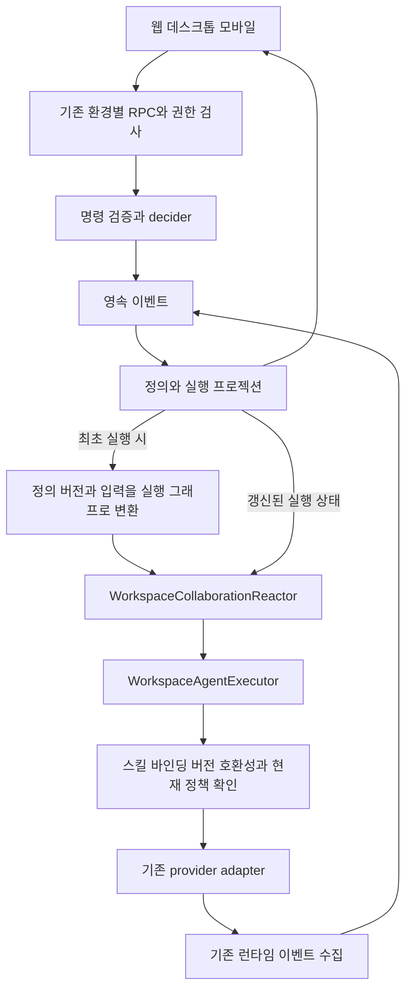

# T3 AI Workflow 개발 계획

T3에서 반복하는 조사·구현·검증 작업을 워크플로로 저장하고, 입력만 바꾸어 다시 실행할 수 있게 한다. 사용자는 단계와 의존성을 편집하고 각 단계의 실행 상태, 결과, 변경 파일, 검증 근거를 같은 화면에서 확인한다. 기존 오케스트라의 작업 그래프와 provider 실행 경로를 확장한다.

계획 작성일은 2026년 10월 26일이다. 첫 배포 범위는 템플릿, 순차·병렬 DAG 실행, 스킬 발견·선택·버전 고정·단계 연결, 일시정지·재개·취소, 안전한 실패 단계 재시도, 웹·데스크톱 편집, 모바일 실행 관리다. 조건 분기와 범용 자동화 노드는 다음 배포 범위로 정한다.

구현 담당은 이 요청을 수행하는 Codex 에이전트다. 저장소 조사부터 분리 후보 작성, 구현, 집중 검증, 승인된 범위의 운영 적용까지 직접 처리한다. 단계가 바뀌거나 다른 도구를 사용한다는 이유로 같은 승인을 다시 요구하지 않는다. 계획표는 사람 1명의 작업일 추정 대신 제가 수행할 순서·산출물·통과 조건을 기준으로 관리한다.

Claude 스킬과 외부 워크플로 스킬 14개, 로컬 스킬 5개의 관련 절차를 분석한 [스킬 분석과 적용 결정](t3-workflow-skills-analysis-2026-10-26.md)을 반영했다. 원문에 있는 반복 승인·subagent 강제·전체 검사·브라우저 자동 열기·PowerShell 예시는 현재 사용자 지시와 T3 개발 규칙에 맞게 조정한다.

## 개발 방향

- 실행은 `WorkspaceCollaborationReactor`와 `WorkspaceAgentExecutor`에 연결한다. 이벤트·프로젝션·대화·사용량·worktree 관리도 기존 경로를 사용한다.
- 워크플로 정의와 실행을 분리한다. 정의는 버전이 있는 템플릿이고, 실행은 특정 정의 버전·입력·권한 선택을 고정한 기록이다.
- 첫 편집기는 단계 목록과 설정 패널로 만든다. 같은 편집 상태와 명령에 React Flow 캔버스를 연결한다.
- 스킬은 기존 에이전트 단계에 연결한다. 공통 메타데이터와 provider 전용 옵션을 구별하고 본문·참조 파일을 필요한 단계에서 읽는다.
- 실행 상태는 서버가 결정한다. 브라우저·데스크톱·모바일은 같은 계약과 읽기 모델을 사용한다.
- 사용자가 현재 요청에 선택한 권한, 질문하기, 조건확인, 계획 모드와 참가자를 보존한다. 워크플로 도입을 이유로 별도 실행 승인을 추가하지 않는다.

## 현재 구현과 추가할 기능

아래 기존 동작은 현재 작업 트리의 코드와 문서를 읽어 확인한 구조다. 실제 동작의 회귀 기준은 S01에서 집중 테스트로 확보한다.

| 영역        | 현재 기반                                                                                                                                                                             | 추가할 기능                                                                  |
| ----------- | ------------------------------------------------------------------------------------------------------------------------------------------------------------------------------------- | ---------------------------------------------------------------------------- |
| 작업 그래프 | [WorkspaceTaskGraph](../../packages/contracts/src/orchestration.ts), [그래프 구체화·준비 작업 선택](../../apps/server/src/orchestration/workspaceTaskGraph.ts)                        | 재사용 가능한 정의, 입력 변수, 정의 버전에서 실행 그래프로 변환하는 컴파일러 |
| 실행        | [협업 reactor](../../apps/server/src/orchestration/Layers/WorkspaceCollaborationReactor.ts), [agent executor](../../apps/server/src/orchestration/Services/WorkspaceAgentExecutor.ts) | 저장한 그래프를 실행하는 진입 경로, 단계 사이 일시정지, 안전한 재시도        |
| 저장        | [협업 실행 프로젝션](../../apps/server/src/persistence/Layers/ProjectionWorkspaceCollaborationRuns.ts)에서 그래프·시도·검증 결과 저장                                                 | 정의와 불변 버전 저장, 실행 시작 시 정의·입력·정책 스냅샷 기록               |
| 실행 프로필 | `WorkspaceExecutionProfile`에 참가자·오케스트라 설정·검증 명령 저장                                                                                                                   | 템플릿과 프로필을 연결하고 현재 요청의 선택을 우선 적용                      |
| 편집·표시   | [WorkspaceTaskGraphView](../../apps/web/src/components/control-center/WorkspaceTaskGraphView.tsx), 계획 검토 명령의 제목·작업·참가자·의존성 수정                                      | 실행 전 템플릿 편집, 초안·저장 버전 구분, 목록 편집기와 캔버스               |
| 전달 추적   | [ProviderExecutionContext](../../packages/contracts/src/providerExecution.ts), [agent control](../../packages/contracts/src/workspaceAgentControl.ts)에 실행 식별자와 전달 상태 존재  | 워크플로 단계의 제출·수락·전달 불명 상태 연결과 재시도 판정                  |
| 복구        | [개발 작업 복구](../../apps/server/src/orchestration/workspaceDevelopmentRecovery.ts)에 전달 불명 보호 규칙 존재                                                                      | 해당 규칙을 협업 단계의 복구에도 적용할 위치 확인·보강                       |
| 자동화·예약 | [자동화 요약 계약](../../packages/contracts/src/workspaceAutomation.ts), [예약 reactor](../../apps/server/src/orchestration/Layers/WorkspaceSchedulerReactor.ts)                      | 특정 워크플로 버전의 예약 실행과 기존 요약 화면 연결                         |
| 모바일      | [협업 실행 화면](../../apps/mobile/src/features/orchestration/WorkspaceCollaborationRunsRouteScreen.tsx)과 자동화 요약                                                                | 저장 템플릿 실행, 입력·상태 조회, 일시정지·재개·취소·재시도                  |
| 스킬 목록   | [ServerProviderSkill](../../packages/contracts/src/server.ts), [Claude 목록 검색](../../apps/server/src/provider/Drivers/ClaudeSkills.ts)                                             | 호출 가능 여부·호환성·namespace·내용 해시와 상세 진단                        |
| 스킬 관리   | [ExtensionManager](../../apps/server/src/extensions/ExtensionManager.ts)에서 폴더 설치·업데이트·활성화와 교체 복구                                                                    | 기존 관리 흐름에 패키지 manifest·버전 고정·실행별 참조 추가                  |
| 스킬 선택   | [웹 검색](../../apps/web/src/providerSkillSearch.ts)과 모바일 composer                                                                                                                | 수동 호출 제한과 지원 상태를 반영한 공통 선택 로직, 단계별 바인딩            |

현재 그래프는 작업 종류, 의존성, 시도 기록, 검증 결과, worktree, 대화 연결을 이미 갖는다. 계획 제안의 작업 노드는 최대 24개이고 검증·종합 노드는 구체화 과정에서 붙는다. 오케스트라 병렬 폭은 최대 6이다. 첫 버전은 이 상한과 같은 쓰기 체인의 동시 실행 방지 규칙을 유지한다.

`RuntimeReceiptBus`는 테스트와 harness가 비동기 처리 지점을 기다리는 장치다. 운영 완료 판단과 다음 단계 실행은 저장된 도메인 이벤트, 그래프 상태, 검증 결과를 사용한다. 테스트에서 기다리는 receipt와 그래프에 저장되는 `WorkspaceTaskValidationReceipt`를 구분한다. [receipt 서비스 정의](../../apps/server/src/orchestration/Services/RuntimeReceiptBus.ts), [용어집](glossary.md)을 따른다.

## 사용 흐름

1. 프로젝트 제어센터의 워크플로 목록에서 새 초안을 만들거나 기본 템플릿을 복제한다. 채팅에서 만든 작업 계획도 템플릿으로 저장할 수 있다.
2. 단계별 작업 내용, 담당 참가자 또는 역할, 의존성, 입력 변수, 사용할 스킬과 인자, 성공 기준을 편집한다. AI로 초안을 만들 때도 같은 계약 검사를 통과시킨다.
3. 실행 구조 미리보기로 누락 입력, 순환, 스킬 버전·호환성, 지원하지 않는 provider, worktree 요구 조건과 실제 실행할 단계를 확인한다. 미리보기는 provider 호출이나 파일 변경, 스킬의 동적 명령·hook 실행을 발생시키지 않는다.
4. 정의 버전을 저장하고 현재 프로젝트·입력·참가자·권한 선택으로 실행한다. 사용자가 켠 질문하기·조건확인·계획 검토만 기존 동작에 따라 적용한다.
5. 실행 화면에서 단계 상태, 대화, 결과, 사용량과 검증 근거를 확인한다. 일시정지·재개·취소와 허용된 실패 단계 재시도를 수행한다.
6. 같은 템플릿을 다시 실행하면 새 실행 ID를 만든다. 이전 실행 기록은 보존하고 완료 결과를 자동으로 새 작업의 실행 증거로 사용하지 않는다.

저장·실행·일시정지·취소는 다른 상태다. 템플릿을 저장하거나 AI로 초안을 만든 것만으로 실행하지 않는다. 실행 완료 표시는 종합 답변뿐 아니라 선택된 완료 검증 조건까지 반영한다.

## 첫 버전 기능

### 템플릿과 입력

- 프로젝트별 생성·조회·수정·복제·보관·보관 해제와 JSON 가져오기·내보내기를 제공한다.
- 초안 수정은 `expectedRevision`으로 충돌을 확인한다. 실행 가능한 저장 버전은 불변이며, 편집하면 새 버전을 만든다.
- 입력은 이름, 자료형, 필수 여부, 기본값을 갖는다. 첫 지원형은 문자열·숫자·불리언·프로젝트 상대 경로다.
- 템플릿에는 credential 값과 다른 environment의 절대 경로를 저장하지 않는다. provider·계정 연결은 실행 environment에서 확인한다.
- 예약은 정의의 특정 버전을 참조한다. 새 버전 저장이 기존 예약의 작업 내용을 자동으로 바꾸지 않으며, 예약 버전 변경은 명시적인 편집으로 처리한다.

### 단계와 데이터 전달

첫 버전은 현재 그래프가 지원하는 조사·구현·디버깅·조정 작업을 템플릿 단계로 제공한다. 기존 구체화 규칙에 따라 검증과 최종 종합을 연결한다. 템플릿 UI는 사용자 작성 단계와 자동으로 생성되는 검증·종합 단계를 구분해 보여준다.

각 단계에는 작업, 목표, 입력, 범위·제약, 기대 결과, 성공 기준, 의존성, 담당 연결을 둔다. 참가자 선택 방식과 기존 역할 연결 방식은 현재 실행 모델을 유지한다. 단일 작업 템플릿의 참가자 수를 맞추려고 사용자가 고르지 않은 계정을 추가하지 않는다.

초기 전달 단위는 기존 handoff와 단계 출력이다. JSON을 요구하는 템플릿은 별도 스키마 검증을 통과한 `data`만 구조화된 입력으로 사용하며, 원문 출력과 오류를 함께 보존한다. 의존 작업의 필요한 결과만 다음 단계에 전달하고 전체 실행 이력을 매번 프롬프트에 붙이지 않는다. 큰 결과와 로그는 증거 참조로 읽는다.

### 스킬 연결과 실행 관측

스킬의 자연어 절차와 T3의 실행 그래프를 구별한다. `SKILL.md`를 읽은 것만으로 실행 가능한 노드·분기·권한을 확정하지 않는다. 절차를 템플릿으로 제안하는 경우에는 입력·노드·담당·의존성을 별도 계약으로 검증한다.

| 기능       | 첫 버전 처리                                                                                                             |
| ---------- | ------------------------------------------------------------------------------------------------------------------------ |
| 발견·선택  | 기존 provider·확장 관리 목록 재사용. 이름만으로 식별하지 않고 provider·scope·namespace·원본을 연결                       |
| 메타데이터 | 공통 형식과 Claude·Codex 전용 필드 보존. 자동 호출 제한·사용자 호출 가능 여부·인자·호환성 표시                           |
| 로딩       | 목록에는 메타데이터만 제공. 선택된 본문과 필요한 참조 파일만 읽고 사용자 필수 지시는 계속 유지                           |
| 버전 고정  | `SKILL.md`·참조·scripts·assets의 상대 경로와 해시 manifest 기록. native provider가 실제로 읽을 경로와 버전 확인          |
| 단계 연결  | 기존 에이전트 단계에 `SkillBinding` 추가. native 호출과 instruction 적용을 구별하고 지원하지 않는 확장은 명시적으로 표시 |
| 실행 기록  | 호출 요청·로딩 관측·실행 관측·결과 검증을 구별. 관측되지 않은 실제 사용을 완료나 사용량으로 추정하지 않음                |
| 평가       | 호출 적합성, 잘못된 호출, 인자·지원 여부, 산출물·복구 결과를 고정 fixture로 비교                                         |

스킬 목록·미리보기·패키지 검사는 실제 실행과 구별한다. `allowed-tools`, 별도 문맥·모델·추가 작업자 요구가 앱의 현재 권한·계획·참가자 선택을 바꾸지 않게 한다. 지원되지 않는 native 옵션을 삭제하거나 다른 방식으로 조용히 대체하지 않는다. 스킬의 `scripts/`는 현재 실행 경로의 도구·정책을 거쳐 필요한 경우에만 사용한다.

실행 중 원본 스킬이 갱신되어도 저장된 패키지 버전을 확인해 재개한다. snapshot을 저장한 것만으로 native provider도 그 버전을 읽었다고 판단하지 않는다. 실제 연결 경로·해시·가능한 로딩 이벤트를 확인하고 확인할 수 없는 부분을 표시한다.

### 실행 관리

| 동작           | 처리 규칙                                                                                              |
| -------------- | ------------------------------------------------------------------------------------------------------ |
| 시작           | 같은 요청 ID·같은 내용의 재전송은 기존 실행을 반환한다. 같은 요청 ID로 내용이 바뀌면 충돌을 반환한다.  |
| 일시정지       | 요청을 저장한 즉시 신규 단계 배정을 멈춘다. 이미 수락된 단계가 정리되면 일시정지로 표시한다.           |
| 재개           | 같은 실행 ID·정의 버전·입력·정책으로 남은 단계를 이어간다. 시도·사용량 예산은 초기화하지 않는다.       |
| 취소           | 신규 배정을 차단하고 실행 중인 provider에 중단을 요청한다. 중단 확인 전에는 취소 요청 상태를 표시한다. |
| 단계 재시도    | 실패 단계의 전달·종료 상태를 확인한 뒤 새 attempt를 만든다. 완료한 형제 단계는 재실행하지 않는다.      |
| 완료 단계 변경 | 기존 실행을 덮어쓰지 않고 새 실행으로 시작한다. 부분 재실행과 하위 결과 무효화는 후속 범위다.          |
| 보관           | 새 수동 실행·새 예약 시작에서 제외한다. 진행 중 실행과 과거 정의 버전은 보존한다.                      |

일시정지는 진행 중인 CLI를 강제로 정지했다가 그대로 되살리는 기능으로 표현하지 않는다. 단계 사이에서 새 배정을 멈추는 방식으로 제공한다. 사용자 질문 대기, 사용량 한도 대기, 일시정지, 의존성 대기는 읽기 모델에서 각각 구별한다.

### 기본 템플릿

| 템플릿             | 흐름                                                                | 확인할 결과                                                 |
| ------------------ | ------------------------------------------------------------------- | ----------------------------------------------------------- |
| 기능 개발          | 요구 분석 → 구현 → 집중 검증 → 결과 정리                            | 변경 파일, 검증 명령·종료 코드, 미해결 항목                 |
| 오류 수정          | 재현·원인 조사 → 수정 → 회귀 검증 → 결과 정리                       | 재현 근거와 수정 후 같은 조건의 결과                        |
| 외부 자료 조사     | 범위를 나눈 조사 → 근거 대조 → 종합                                 | 원문 URL·수집 시각·확인 범위                                |
| 변경 검토          | 범위를 나눈 검토 → 발견 사항 대조 → 보고                            | 파일·위치·재현 조건과 조치 필요성                           |
| 워크플로 작성·복구 | 실제 계약 확인 → 단계 구성 → 구조·연결 검증 → 격리 실행 → 결과 확인 | 초안과 적용 버전, 잘못 연결된 단계, 실제 출력과 오류        |
| 스킬 비교·개선     | 원본·후보 고정 → 같은 평가 입력 실행 → 결과 비교 → 개선안 정리      | 호출 적합성, 산출물 검사, 버전·해시·사용량·지연과 남은 한계 |

기능 개발에는 작업별 파일·인터페이스·검증 기준, 오류 수정에는 재현과 가설 검증, 조사에는 필요한 문맥의 점진 보강, 검토에는 실행 증거에 따른 완료 판단을 연결한다. 스킬 비교·개선은 분리된 후보와 평가 기록을 만들며 사용자 공용 원본 스킬을 자동으로 덮어쓰지 않는다.

자동 커밋·병합·배포는 기본 템플릿의 완료 단계에 포함시키지 않는다. 해당 행동을 요청한 작업은 기존 범위와 정책에 맞는 별도 단계로 구성한다.

## 데이터와 실행 구조

다음 이름은 추가할 계약과 파일의 제안이다. 기존 심볼과 구별한다.

| 구성                          | 주요 내용                                                                   | 배치 제안                                                                          |
| ----------------------------- | --------------------------------------------------------------------------- | ---------------------------------------------------------------------------------- |
| `WorkspaceWorkflowDefinition` | ID, 프로젝트, 제목, 초안 revision, 보관 상태                                | `packages/contracts/src/workspaceWorkflow.ts`                                      |
| `WorkspaceWorkflowVersion`    | 불변 version ID, schemaVersion, 입력 정의, 작업 DAG, 내용 해시              | 같은 계약 파일과 정의 프로젝션                                                     |
| `WorkspaceWorkflowExecution`  | definition/version 참조, 입력 스냅샷, 적용 정책, 원본 입력 참조, pause 상태 | 기존 협업 실행에 선택 필드로 연결                                                  |
| `compileWorkspaceWorkflow`    | 변수 치환, 그래프·담당 검증, 기존 작업 노드 구체화                          | `apps/server/src/orchestration/workspaceWorkflow.ts`                               |
| 정의 명령과 조회              | 생성·저장·보관·복제, 목록·버전·미리보기                                     | 기존 command/decider/projector 및 RPC 체계                                         |
| 단계 실행 추적                | run/node/attempt/execution ID, 제출 의도, 수락·전달 불명·종료 근거          | 현재 provider 실행 추적과 협업 저장 경로 확장                                      |
| 클라이언트 상태               | 환경·프로젝트별 목록, 초안, 실행 상태, mutation 오류                        | `packages/client-runtime/src/state/workflow.ts`                                    |
| `SkillMetadata`·`SkillRef`    | 공통·provider 전용 필드, namespace·scope, 원본·내용 해시, 지원 상태         | 새 `packages/contracts/src/agentSkills.ts`와 기존 `server.ts`·`extensions.ts` 연결 |
| `SkillBinding`                | 단계별 선택, 인자, native/instruction 방식, 필요한 capability               | 같은 계약과 기존 노드의 선택 필드                                                  |
| 스킬 해석·snapshot            | 공통 경로 해석, 파일 manifest, native 적용 경로·해시 확인                   | 기존 provider·ExtensionManager 확장과 `apps/server/src/skills/`의 작은 모듈        |
| 스킬 평가                     | 고정 fixture·결정적 검사·기준 비교, 호출·결과의 구별                        | 기존 실행 경로를 사용하는 평가 헬퍼와 결과 artifact                                |

정의 생성·저장·보관과 실행 상태 변경은 명령·이벤트 경로로 처리한다. 프로젝션을 직접 바꾸어 도메인 변경을 우회하지 않는다. 기존 `graph: null` 실행과 새 워크플로 필드가 없는 실행을 계속 읽을 수 있도록 디코딩 기본값을 둔다.

정의 변경에는 프로젝트별 이벤트 순서와 revision 검사를 적용한다. 실행에는 정의 내용 해시와 입력 해시를 기록해 템플릿 편집과 실행 복구를 구분한다. 내용 해시는 외부 작업의 중복 방지 키를 대신하지 않는다.

워크플로 전용 추가 필드가 실행 프로젝션과 이벤트 재생에서 왕복하는지 확인한 뒤 컴파일러를 연결한다. 직접 실행에서는 저장 버전으로 그래프를 만들고, 기존 AI 계획 실행은 현재 진입 경로를 유지한다. AI 초안 생성 결과도 동일한 정의 검증기를 통과시킨다.

실행 제어는 협업 실행의 선택 필드에 `active`, `pause-requested`, `paused`를 저장해 기존 run 상태와 함께 해석한다. `paused` 실행도 복구 조회에는 포함하되 자동 배정을 하지 않는다. 클라이언트에는 이를 일시정지로 표시한다. 재개는 저장된 그래프를 사용하며 현재 템플릿을 다시 컴파일하지 않는다.

단계 재시도 명령은 `expectedRevision`과 대상 node ID를 검사한다. provider 종료와 전달 상태가 확인된 실패 실행만 같은 run에서 다시 열고, 대상 단계의 attempt를 추가한 뒤 필요한 의존성 대기를 갱신한다. 완료·취소 실행을 같은 명령으로 다시 열지 않는다. 재시도와 취소가 동시에 오면 저장 순서와 최신 상태 검사로 취소된 작업의 배정을 막는다.

첫 배포는 environment당 기존 단일 backend 실행 소유권을 전제로 한다. 여러 기기는 같은 backend에 연결한다. 같은 DB를 여러 서버가 동시에 실행하는 active-active 구성은 후속 범위이며, 현재 메모리의 run claim을 분산 잠금으로 간주하지 않는다.

## 권한과 복구 규칙

### 현재 요청의 선택 보존

실행 시작 시 `runtimeMode`, `interactionMode`, `askFirst`, `reviewPlan`, 승인된 작업 조건, 참가자·계정, `allowAdditionalWorkers`와 적용 프로필 revision을 저장한다. 템플릿의 추천값과 저장 프로필이 현재 요청의 명시적 선택을 덮어쓰지 않도록 적용 순서를 하나의 공통 함수로 만든다.

새 실행·참가자 변경·재시도·예약 연결에서 정책 전달을 검사한다. 현재 요청의 조건이 `inspect`이면 상태를 바꾸는 구현 단계를 실행하지 않는다. 전체 권한에서도 사용자가 직접 선택한 질문하기·조건확인·계획 모드를 유지한다. 지원하지 않는 권한 표현은 실행 전에 구체적인 이유와 함께 실패시키며 권한을 임의로 바꾸지 않는다.

### 제출과 재시도

단계를 provider에 보내기 전에 제출 의도와 실행 식별자를 영속화하고, provider가 수락한 뒤 native session·turn·message 식별자와 수락 근거를 기록한다. 명령 저장과 외부 제출 사이의 장애를 고려해 실행 상태를 복구한다.

수락 여부가 불명확하면 기존 native session의 상태와 이벤트로 먼저 대조한다. 확인할 수 없는 작업은 전달 불명 상태로 보존한다. checkout, 코드, 목표나 템플릿 버전 변경은 수락 여부의 증거로 사용하지 않는다. 같은 입력을 자동으로 다시 보내지 않는다.

재시도는 일시적인 실패와 이미 종료·미수락이 확인된 작업을 대상으로 하고, 저장된 상한을 적용한다. provider 정책 거부를 다른 계정으로 바꾸어 자동 반복하지 않는다. 외부 쓰기가 도입되는 단계에서는 해당 API의 idempotency 지원과 결과 확인 방법을 따로 설계한다. 지속성 있는 실행만으로 외부 부수 효과의 정확히 한 번 실행을 보장한다고 표시하지 않는다.

### 취소와 지연 결과

취소 요청 뒤에는 준비된 다음 단계를 새로 시작하지 않는다. 이미 수락된 작업의 중단·종료 여부를 추적하고, 늦게 온 결과는 해당 execution ID의 증거와 사용량으로만 반영한다. 취소된 실행을 다시 실행 중으로 바꾸거나 다음 단계를 깨우지 않는다. 사용량은 native 사용량 이벤트의 기존 중복 제거 경로를 사용하며, 보고하지 않은 사용량을 0으로 표시하지 않는다.

검증 완료와 provider 응답 완료도 구분한다. `completionCheck`가 켜진 실행은 현재 delivery 검증 결과와 worktree 통합 상태를 완료 판단에 반영한다. 템플릿 기능이 기존 결과 검증을 생략하지 않도록 한다.

## 클라이언트와 provider 적용

| 대상           | 첫 버전 적용                                                                                       |
| -------------- | -------------------------------------------------------------------------------------------------- |
| 웹             | 목록·폼·캔버스 편집, 입력·실행, 단계 관리, 결과·근거 확인                                          |
| 데스크톱       | 같은 웹 기능 사용. 파일·경로와 Electron 연결에 필요한 기존 API 재사용                              |
| 모바일         | 저장 템플릿 선택과 입력, 실행·상태·근거, 일시정지·재개·취소·안전한 재시도. 전체 그래프 편집은 후속 |
| 공통 상태      | 환경 ID·프로젝트 ID를 모든 조회와 mutation에 포함. 여러 기기의 오래된 revision 충돌 처리           |
| 진입점         | 프로젝트 제어센터, 채팅의 계획 저장·템플릿 실행, 명령 팔레트·관련 설정·단축키 경로 점검            |
| 연결           | 로컬, 원격, relay·터널에서 같은 RPC 사용. localhost origin을 번들에 고정하지 않음                  |
| 예약·후속 작업 | 기존 scheduler·후속 작업에 저장 버전 연결. 주기 중복 트리거와 수동 실행의 구분 유지                |

Codex·Claude·Cursor·Grok·OpenCode와 현재 등록된 추가 adapter별로 일반 실행, streaming, 수락 근거, native 재연결, 취소 확인, 구조화 출력, 사용량 보고, 스킬 발견·호출·인자·버전 고정·로딩 관측 지원을 표로 확인한다. 모든 adapter가 같은 복구 기능을 제공한다고 가정하지 않는다. 지원하지 않는 동작은 명시적인 capability 오류로 표시하고 기본 실행 경로는 기존 adapter를 사용한다. 새 API 키나 provider 서비스 가입을 워크플로의 필수 조건으로 만들지 않는다.

웹·데스크톱·모바일의 기존 스킬 picker와 새 워크플로 단계 설정은 같은 호출 제한·지원 상태를 사용한다. 스킬 관리 화면에서 비활성화·업데이트할 때 영향받는 저장 템플릿과 실행의 고정 버전을 확인할 수 있게 한다. 다른 기기에 표시되는 경로는 실행 서버 기준이며, 클라이언트의 로컬 경로로 해석하지 않는다.

실행 목록에는 단계 수·상태·시간·사용량·오류 요약만 보내고 큰 원문은 선택 시 읽는다. 기존 조회 상한을 유지하고 새 정의 목록은 페이지 단위로 조회한다. 캔버스는 해당 화면에 들어갈 때 로드하며, 상태가 바뀐 노드만 갱신한다. 간선·노드의 지속 애니메이션은 사용하지 않는다.

## 에이전트 실행 계획표

제가 아래 순서로 처리한다. 각 단계 안에서도 파일·인터페이스·검증 명령이 정해진 작은 작업으로 나누고, 실제 통과 기록이 생긴 뒤 다음 작업을 이어간다. 사람의 작업일을 에이전트 완료 시간으로 환산하지 않으며, 소요 시간·사용량은 실행 기록에 따라 갱신한다.

| 순서                         | 제가 수행할 작업과 산출물                                                                                | 선행 조건과 통과 기준                                                                  | 현재 상태           |
| ---------------------------- | -------------------------------------------------------------------------------------------------------- | -------------------------------------------------------------------------------------- | ------------------- |
| S00 자료·기준 분석           | 현재 T3 실행·스킬 코드, Claude·공통 규격, 외부 14개·로컬 5개 스킬의 적용·조정 결정                       | 원문 commit·로컬 해시·설치 SDK 확인과 이 계획 반영                                     | 분석·계획 반영 완료 |
| S01 분리 후보와 회귀 기준    | 기존 변경을 보존한 후보, 격리 DB·fixture, provider·스킬 capability 표, Claude home 경로 불일치 후보 검증 | 기존 그래프·권한·사용량·스킬 관리 동작의 집중 결과 확보. 실제 결함과 설계 차이 구분    | 구현 대기           |
| S02 정의와 스킬 계약         | Workflow 정의·버전·입력, SkillMetadata·Ref·Binding, 명령·이벤트·프로젝션·마이그레이션                    | 구버전 디코딩·이벤트 재생·revision 충돌 처리, 공통과 native 필드 구별                  | 구현 대기           |
| S03 스킬 목록과 버전         | 기존 catalog·ExtensionManager 연결, 호출 제한, 파일 manifest·원본/실행 해시, provider 경로 해석          | 동명·비활성·잘못된 YAML·누락 참조 처리. 목록 조회 시 명령·hook 실행 0건                | 구현 대기           |
| S04 native 호출과 정책       | 단계별 스킬·인자 전달, capability 검사, native/instruction 구별, 적용 관측 기록                          | 사용자 권한·질문·계획·참가자 유지. 지원 불가 조합을 조용히 대체하지 않음               | 구현 대기           |
| S05 그래프 컴파일과 템플릿   | 저장 버전→기존 DAG 변환, AI 초안 검증, 기본 템플릿 6종, 스킬·입력 스냅샷                                 | 같은 정의·입력·고정 스킬이 같은 그래프 생성. 순차·병렬·검증·종합 연결                  | 구현 대기           |
| S06 복구와 실행 제어         | 일시정지·재개·취소·실패 단계 재시도, 전달 불명 대조, 스킬 버전 변경과 문맥 축약 후 재개                  | 중복 제출·취소 뒤 배정·사용량 이중 집계 0건. 완료 작업·정책·스킬 버전·예산 보존        | 구현 대기           |
| S07 편집기와 모든 클라이언트 | 단계 폼·캔버스·스킬 선택, 실행·근거 화면, 모바일 관리, 예약 버전·원격 재접속                             | 폼↔캔버스 보존, 공통 호출 제한, 여러 기기 상태 일치와 오래된 명령 거부                 | 구현 대기           |
| S08 평가와 통합 검증         | 24개 스킬 선택 사례, baseline/후보 비교, 변경 범위 회귀·성능·결과 artifact                               | 잘못된 스킬 호출·지원 불가 확장·권한 변경 검출. 구조 검증과 실제 결과 검증을 별도 통과 | 구현 대기           |
| S09 운영 적용과 복구         | 증거 manifest, 사용자·운영 문서, 기능 활성화, 기존 관리자 실행기로 운영 교체                             | 아래 완료 기준과 실제 web·backend·desktop High 토큰·창·렌더링 확인                     | 구현 대기           |

구현 시작 시 작업별 기준 해시, 수정 파일·인터페이스, 검증 명령·종료 코드·로그, 산출물 해시, 결정 이유·남은 문제·다음 작업을 진행 기록에 남긴다. 이 개발 기록은 프로그램의 이벤트 저장소를 대체하지 않는다. 문맥이 축약되거나 턴이 바뀌면 완료 기록과 실제 파일을 확인해 이어가며 같은 작업을 다시 시작하지 않는다.

계약·검증이 통과하면 승인된 다음 작업을 계속한다. 저장소·환경·로그에서 알 수 있는 정보는 제가 확인한다. 새 credential 값이나 사용자만 결정할 수 있는 요구 충돌처럼 필요한 정보가 실제로 없을 때만 해당 항목을 요청하며 독립 작업은 계속한다. subagent 사용·모델 변경을 외부 스킬의 권고만으로 시작하지 않는다.

다수의 미커밋 변경이 있는 현재 작업 트리를 초기 상태로 되돌리거나 그 변경 전체를 이번 기능의 결과로 묶지 않는다. 이미 포함된 기능은 새로 구현하는 대신 검증하고 재사용한다.

## 검증과 완료 기준

backend 동작 변경에는 해당 경로의 집중 테스트를 추가한다. 비동기 테스트는 기존 테스트용 receipt, worker drain과 테스트 clock을 사용한다. 실제 시간 sleep이나 반복 조회로 통과를 기다리지 않는다.

| 검증 대상      | 반드시 확인할 사례                                                                                      |
| -------------- | ------------------------------------------------------------------------------------------------------- |
| 정의           | 중복 ID, 없는 의존성, 순환, 입력형 불일치, 상대 경로 범위, 지원하지 않는 schemaVersion, revision 충돌   |
| 버전           | 실행 중 템플릿 수정·보관, 예약 버전 고정, 이벤트 재생, 구버전 DB 마이그레이션                           |
| 실행           | 순차·병렬·같은 쓰기 체인 직렬화, 잘못된 참가자, 사용자가 허용하지 않은 추가 작업자 배정 방지            |
| 정책           | 전체·제한 권한, plan, askFirst, reviewPlan, 조건확인 inspect/work, 재시도·재개·예약에서의 선택 보존     |
| 중복·장애      | 시작 요청 중복, 제출 직전·직후 장애, 수락 저장 전 장애, 전달 불명 상태, native 재연결 불가              |
| 일시정지       | 요청 뒤 신규 배정 없음, 진행 단계 정리, 서버 재시작 후 pause 상태 유지, 같은 실행으로 재개              |
| 취소           | 배정과 취소의 경합, 중단 미확인 표시, 취소 뒤 지연 결과, 완료된 형제 작업 보존                          |
| 재시도         | 확인된 실패만 재시도, 완료 노드 재실행 방지, 전달 불명 재전송 방지, 시도·수정·사용량 예산 보존          |
| 결과           | malformed JSON, 검증 실패, 종합 완료와 delivery 완료 구분, 원본 오류·증거 참조 보존                     |
| 여러 기기      | 동시 실행 버튼, 오래된 revision으로 조작, 재접속, 다른 environment·프로젝트 혼입 방지                   |
| 스킬 형식·목록 | 공통 형식과 Claude native 기본값, 호출 제한·namespace·동명 충돌·잘못된 YAML·비활성 상태                 |
| 스킬 자원·버전 | 상대 참조·scripts·assets·전용 설정, 누락 자원, 원본 갱신, 제출·재개 시 snapshot과 실제 적용 경로 대조   |
| 스킬 정책·인자 | 직접 선택·자동 선택, 인자 누락, provider 전용 확장·별도 문맥·도구 허용과 현재 선택 충돌                 |
| 스킬 관측·평가 | 호출 요청과 실제 로딩 구분, 필요한 참조만 읽기, 문맥 축약 후 지시 보존, baseline·후보의 실제 결과       |
| 성능           | 계획 작업 24개와 자동 생성 노드가 있는 그래프, 실행 이력 누적, 큰 출력, 캔버스 진입 전 bundle·렌더 영향 |

성능 비교는 같은 장비·fixture에서 기존 화면과 변경 화면을 교대로 측정한다. 초기 목표는 관련 RPC P95와 화면 갱신 P95의 기준 대비 악화 10% 이내, 편집 화면의 단일 긴 작업 50ms 초과 지점 조사, 그래프 미사용 화면에서 캔버스 코드 미로딩이다. 이 수치는 앞으로 검증할 목표이며 현재 측정 결과가 아니다. 지속 애니메이션과 전체 실행 원문 반복 전송 여부도 확인한다.

스킬 선택 평가는 호출해야 하는 요청 8개, 호출하지 않아야 하는 유사 요청 8개, 직접 호출·인자 4개, 지원하지 않는 provider 확장 4개로 시작한다. baseline과 후보의 fixture·provider·모델·설정·패키지 해시를 고정하고 최종 확인용 사례를 분리한다. 결정적 검사를 우선하며 프롬프트 토큰 추정과 provider 보고 사용량을 구별한다. 평가 자체의 성공을 실제 운영 성공으로 표시하지 않는다.

집중 회귀는 변경한 범위에서 다음 기존 테스트와 새 워크플로 테스트를 선택한다.

- `packages/contracts/src/orchestration.test.ts`와 새 `workspaceWorkflow.test.ts`.
- `apps/server/src/orchestration/workspaceTaskGraph.test.ts`와 새 컴파일러 테스트.
- `apps/server/src/orchestration/Layers/WorkspaceCollaborationReactor.test.ts`와 `WorkspaceCollaborationReactor.meeting.test.ts`.
- `apps/server/src/orchestration/Layers/WorkspaceAgentExecutor.test.ts`, `workspaceDevelopmentRecovery.test.ts`, `WorkspaceOrchestraDelivery.test.ts`.
- 실행 저장 마이그레이션·프로젝션 테스트와 `packages/client-runtime`의 새 workflow 상태 테스트.
- 웹 편집·레이아웃과 모바일 실행 관리의 변경 범위 테스트, 해당 프로젝트의 lint·Effect tsgo 타입 검사.
- `apps/server/src/provider/Drivers/ClaudeSkills.test.ts`, `apps/server/src/extensions/ExtensionManager.test.ts`, `apps/web/src/providerSkillSearch.test.ts`와 새 공통 스킬 계약·snapshot·호출 테스트.

저장소 전체 검사와 전체 테스트는 이 계획의 기본 검증에 포함하지 않는다. Bun 타입 검사는 기존 Effect 검사와 lint·테스트를 대체하지 않는다. 브라우저를 이용한 통합 확인은 사용자가 요청·동의한 범위에서 headless로 수행하고 입력·포커스를 조작하지 않는다. 실행 기기에서 확인하지 못한 부분은 검증 기록에 남긴다.

첫 배포의 완료 조건은 다음과 같다.

1. 기본 템플릿 6종을 저장·편집·실행하고 스킬 연결과 단계별 증거까지 조회한다.
2. 일시정지·재시작·재개에서 완료 작업과 현재 정책·예산이 보존된다.
3. 중복 제출, 전달 불명 자동 재전송, 취소 뒤 새 배정, 사용량 이중 집계가 검증 사례에서 0건이다.
4. 웹·데스크톱·모바일과 로컬·원격 연결에서 지원 범위에 맞는 동일한 결과를 보여준다.
5. 변경 범위 테스트·타입 검사·lint와 정의·DB 호환성 검증을 통과한다.
6. 비교 결과·남은 한계·복구 자료를 남기고 실제 운영 적용 상태까지 확인한다.
7. 스킬 버전·호환성·호출 제한과 실제 적용 상태를 구별하고, 고정 사례의 선택·정책·산출물 검증을 통과한다.

## 후속 배포

| 기능               | 설계 조건                                                                                                                                   |
| ------------------ | ------------------------------------------------------------------------------------------------------------------------------------------- |
| 조건 분기          | 검증된 구조화 출력에 대한 명시적 비교식 사용. 제어 노드 상태를 영속화하고, 선택되지 않은 경로와 합류의 의미를 정의한 뒤 기존 scheduler 확장 |
| 제한 반복          | 최대 반복 수·총 실행 예산·종료 조건을 둠. 기존 DAG 순환 금지를 무제한 loop 허용으로 변경하지 않음                                           |
| HTTP·MCP·명령 노드 | 기존 도구·권한·credential 경로에 연결. 제출·결과 대조·취소·중복 방지 능력을 작업 종류별로 정의                                              |
| 사용자 입력 노드   | 명시적으로 추가된 입력 단계와 현재 요청의 질문하기 모드를 구분. 저장된 질문 ID·revision으로 답변 처리                                       |
| 부분 재실행        | 바뀐 단계의 하위 결과를 무효화하고 실행 세대를 분리. 이전 외부 쓰기의 효과를 새 실행 성공으로 간주하지 않음                                 |
| 외부 연동          | webhook·공개 API, n8n·Dify 연계, 신뢰 경계와 실행 결과 계약을 확인한 뒤 추가                                                                |
| 여러 서버 실행     | 영속 소유권·만료·fencing, 배포 버전과 진행 중 정의 호환성을 갖춘 뒤 검토                                                                    |

## 참고 자료의 적용 범위

2026-10-26 06:21 UTC 기준으로 아래 저장소의 `main` 전체 commit ID를 조회하고 해당 commit의 README를 확인했다. README의 기능 설명은 설계 참고이며 T3에서 재현한 동작과 구분한다. 이번 계획에서 외부 실행 프레임워크를 설치한 것은 아니며, 실제 라이브러리 도입 시 package와 lockfile 버전을 고정한다. React Flow도 현재 웹 의존성에 등록되어 있지 않다.

| 자료                                                               | 고정한 원문                                                                                                                                          | T3에 적용할 설계                        |
| ------------------------------------------------------------------ | ---------------------------------------------------------------------------------------------------------------------------------------------------- | --------------------------------------- |
| [Sim 원본 저장소](https://github.com/simstudioai/sim)              | [61544827f92e9802517b5f2c4f55a6ab1ef4070c README](https://github.com/simstudioai/sim/blob/61544827f92e9802517b5f2c4f55a6ab1ef4070c/README.md)        | 편집·실행·로그를 이어 보는 제품 흐름    |
| [Dify 원본 저장소](https://github.com/langgenius/dify)             | [aebe697e0c1582cd4924704cad1eff45fbc0f7ab README](https://github.com/langgenius/dify/blob/aebe697e0c1582cd4924704cad1eff45fbc0f7ab/README.md)        | AI 작업·지식·도구와 관측 화면의 연결    |
| [LangGraph 원본 저장소](https://github.com/langchain-ai/langgraph) | [a25bfafe4858d2a85bede09ba83f9a591d1f1133 README](https://github.com/langchain-ai/langgraph/blob/a25bfafe4858d2a85bede09ba83f9a591d1f1133/README.md) | 영속 상태·중단·재개와 실행 추적         |
| [Mastra 원본 저장소](https://github.com/mastra-ai/mastra)          | [c201a1fe2d12877d89ed81ca422fbc934b07a27c README](https://github.com/mastra-ai/mastra/blob/c201a1fe2d12877d89ed81ca422fbc934b07a27c/README.md)       | TypeScript 단계 입출력·명시적 실행 순서 |

[React Flow](https://github.com/xyflow/xyflow)는 편집 UI 후보로 사용한다. [Inngest의 단계·재시도 문서](https://www.inngest.com/docs/durable-execution/primitives)와 [Temporal의 워크플로 문서](https://docs.temporal.io/workflows)는 복구 설계를 검토하는 자료다. T3 실행 엔진의 의존성 추가는 이 첫 배포의 전제로 두지 않는다.

스킬 자료의 전체 commit, 분석한 개별 파일, 로컬 원본 해시, 설치 SDK 버전과 채택·조정 결정은 [별도 분석 기록](t3-workflow-skills-analysis-2026-10-26.md)에 연결한다. 스킬의 설치·본문 로딩·실행 결과·운영 적용을 각각 검증한다.

빌리빌리의 [LangGraph 실습 목차](https://www.bilibili.com/video/BV1ePoNB5EkR/), [Dify 패턴 소개](https://www.bilibili.com/video/BV1JvbjzvEjX/)는 학습 순서 참고다. 검색에 노출된 설명·목차를 확인했으며 영상 전체 검증 자료로 사용하지 않는다. Reddit의 [중복 쓰기와 원본 로그 경험담](https://www.reddit.com/r/n8n/comments/1t6vlme/90_days_of_n8n_ai_workflows_three_things_id/)과 [복잡한 그래프의 개발 경험](https://www.reddit.com/r/n8n_ai_agents/comments/1w3298g/at_what_point_does_an_n8n_workflow_become_harder/)은 검증 사례를 고르는 참고로 사용한다. 개인 경험의 성과 수치를 T3의 예상 개선치로 전환하지 않는다.

## 기준 코드와 운영 적용

기준 HEAD는 `1c42b71116f259dd5e8f9227273ff68b15104816`이다. 분석에는 미커밋 변경이 있는 작업 트리를 사용했으므로 HEAD만으로 이 계획의 기준 파일을 재현할 수는 없다. 주요 파일의 읽기 시점 SHA256은 다음과 같다.

| 파일                                                                         | SHA256                                                             |
| ---------------------------------------------------------------------------- | ------------------------------------------------------------------ |
| `packages/contracts/src/orchestration.ts`                                    | `7acd02ee0d84a3a8ab264554d949bd94ded08fe7d5b0ad9387451eee681ec64a` |
| `packages/contracts/src/providerExecution.ts`                                | `04485b767158e7f8572e761394c5a4dd5ca706a81a8acab1b129be328134ba20` |
| `packages/contracts/src/workspaceAgentControl.ts`                            | `cf9fa672bf4f7736979f9212e93a7cbd3884dd91afda85f266f315f75f0bb809` |
| `apps/server/src/orchestration/workspaceTaskGraph.ts`                        | `6980be6e62842bad66b87747cb030fd0fa73a035603bf286207406ad11d000b3` |
| `apps/server/src/orchestration/Layers/WorkspaceCollaborationReactor.ts`      | `b8f0bd8deea4b45128c7e592798faead39824fe8a0a71fdbc84a7ae3ab9e7577` |
| `apps/server/src/orchestration/Services/WorkspaceAgentExecutor.ts`           | `dacf18d15e4d397680606a0f4f148bc723df4a6b7f337baaca049cbf339087fd` |
| `apps/server/src/orchestration/Services/RuntimeReceiptBus.ts`                | `6fa3299aafa78362e7b121a110b6b36283ac207398bff46f33a7a893ac93c52e` |
| `apps/server/src/persistence/Layers/ProjectionWorkspaceCollaborationRuns.ts` | `84b6244af32f3deaebfad6163a73064e27dc0ee2b0b3be47897801cabab0e118` |
| `apps/web/src/components/control-center/WorkspaceTaskGraphView.tsx`          | `f6e82fea66e909c8d07c52b1692d5d49b5dd2f7dbefbde7e7f040f252ff9569b` |
| `apps/web/package.json`                                                      | `46e05fdd3f7042bbc093b3feb76e2cf1d4874194ba754ad4c56844f1c03a8c64` |

구현 시 [연구 업그레이드 증거 형식](research-upgrade-evidence.md)에 원본·후보 해시, 실제 실행한 집중 검사와 로그, 비교 결과, 복구 자료를 남긴다. 운영 승격 전에는 후보의 증거 manifest를 `node scripts/verify-research-upgrade.ts --manifest <evidence.json> --workspace <candidate-root>`로 검사한다. 이 검사는 실제 테스트와 운영 검증을 대신하지 않는다.

사용자 동작 문서는 `docs/user/`에, 실행 모델과 용어는 `docs/internals/`에, 배포·복구 기록은 `docs/operations/`에 추가한다. 새 기능의 단계 상태와 템플릿 버전 용어는 구현과 함께 용어집에 반영한다.

운영 적용은 [Windows 운영 절차](../operations/windows-runtime-start.md)를 따른다. 기존 데이터 홈 `E:/NewAutoUsage`와 web·backend·desktop 범위를 유지한다. 관리자 예약 작업 `\NewAutoUsage-T3-Administrator`와 기존 `runtime.py` 실행기를 사용하며, 운영 교체 후 실제 창을 `showInactive()`로 표시한다. 서버 상태, 실제 데스크톱의 High 토큰, 창 표시·렌더링까지 확인한다. 분리 검증 창은 숨김 또는 headless로 유지하고 사용자 입력·포커스를 조작하지 않는다. PowerShell은 직접·간접 실행하지 않는다.

문제가 발견되면 워크플로 기능의 신규 시작을 끄고 기존 채팅·협업 경로를 유지한다. 이미 수락된 실행은 상태를 대조한 뒤 정리한다. 정의·실행 이력을 지우는 방식으로 복구하지 않으며, 구버전 앱 복귀는 추가 필드·이벤트·마이그레이션 호환성을 검증한 배포 조합으로 수행한다.
