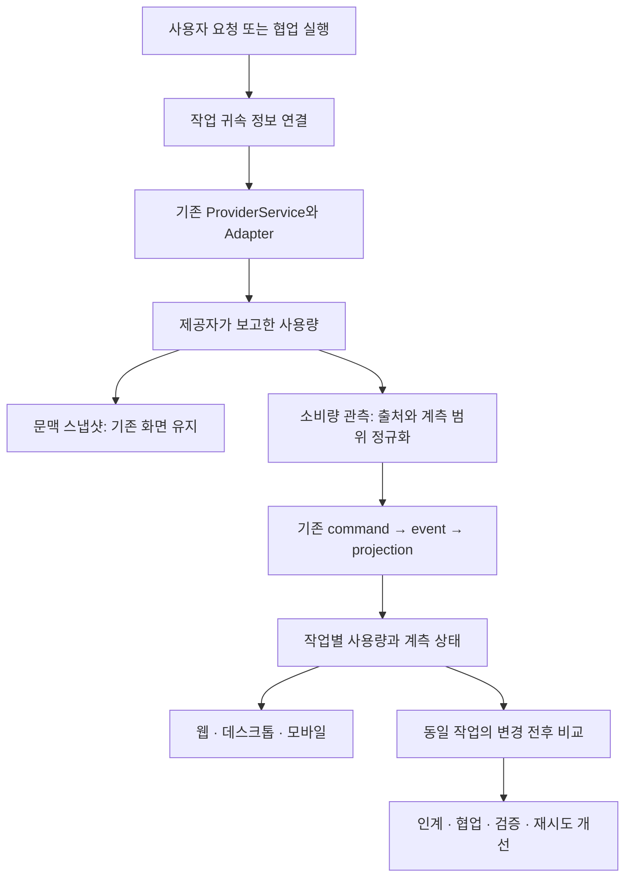

# 토큰 효율 개선 설계

> 상태: 전체 개선 설계안. P0 계측과 보수적인 P1 인계 추출이 구현됐다.
> 적용 범위: [P0 구현 기록](./token-usage-implementation.md), [P1 구현 기록](./conversation-handoff-implementation.md).
> 작성일: 2026-09-05. 기준 HEAD: `304a9099a` 및 조사 당시 작업 트리.
> 목표: 모델·추론 수준·완료 기준을 유지하면서 완료 작업당 전체 모델 사용량을 줄인다.
> 아래 타입·이벤트·테이블·RPC 이름은 설계 제안이다. 실제 이름과 적용 범위는 각 구현 기록을 따른다.

## 1. 결정 요약

1. **계측부터 구현한다.** 현재 문맥 크기와 처리한 토큰 총량을 구분하고, 제공자별 계측 범위를 표시한다.
2. **작업 경계에서 문맥을 정리한다.** 동일 작업을 수행하는 중에는 세션을 유지하고, 목표·모델 전환 시 필요한 결정과 근거를 인계한다.
3. **협업에서는 합의와 변경분을 전달한다.** 완료된 회의 라운드의 원문과 요약을 매번 함께 보내지 않는다.
4. **검증 결과의 근거를 재사용한다.** 대상 코드와 실행 조건이 같을 때 재사용하고, 중요한 변경의 독립 검증은 유지한다.
5. **실패 종류에 맞게 재시도한다.** 형식 오류를 고치기 위해 구현·조사를 다시 실행하지 않는다.

모델 교체, 추론 강도 하향, 작은 숫자의 일괄 문맥 제한은 기본 정책으로 도입하지 않는다. 절감률은 실험 결과로 결정한다. 새로운 에이전트 실행기, 벡터 DB, 별도 분석 서버는 만들지 않는다.

1단계는 관측 기능이다. 모델 프롬프트·세션 수명·재시도 정책을 바꾸지 않아 계측 도입 전후의 기준선을 확보할 수 있어야 한다.

## 2. 조사 근거와 한계

### 2.1 기록에서 확인한 사실

현재 개발 환경의 T3 home에 있는 SQLite를 `readOnly: true`와 `PRAGMA query_only=ON`으로 열어 집계했다. 아래는 2026-09-05 오전 조사 시점의 관측이며, 계속 갱신되는 운영 상태의 고정된 현재값은 아니다. 계정명·대화 원문·세션 식별자는 이 문서에 포함하지 않는다.

| 관측                                     | 값                                          | 해석 범위                                                           |
| ---------------------------------------- | ------------------------------------------- | ------------------------------------------------------------------- |
| 2026-08-29 이후 문맥 사용량 활동         | 26,408개 스냅샷, 21개 스레드, 588개 turn ID | 스냅샷 수는 모델 요청 수나 과금 횟수가 아니다                       |
| 해당 스레드의 마지막 스냅샷, Claude 계열 | 7개, 평균 409,029 토큰, 최대 758,149        | 현재 세션의 제공자 종류로 그룹화한 문맥 크기이며 소비 총량이 아니다 |
| 해당 스레드의 마지막 스냅샷, Codex       | 14개, 평균 150,996 토큰, 최대 210,316       | 모든 마지막 스냅샷에 캐시 입력 구분값이 있었다                      |
| Codex 스냅샷 표본                        | 입력 125,068, 캐시 입력 121,344, 출력 395   | 캐시 입력은 전체 입력의 부분집합이다                                |
| 저장된 협업 실행                         | 49건, 생성일 2026-08-17~20                  | 최근 일반 대화와 다른 기간의 자료다                                 |
| 위 협업 그래프의 실제 시도               | 159회, 이 중 검증 77회                      | 검증의 토큰 비중을 뜻하지 않는다                                    |
| 위 그래프의 실패 시도                    | 20회, 오류 문자열 기준 형식 관련 후보 2회   | 분류는 휴리스틱이며 인과관계를 증명하지 않는다                      |
| 활성 기억 중 자동 삽입 후보              | 프로젝트별 최대 4,604자                     | 검색 자료 원문 전체를 자동 삽입한다는 뜻이 아니다                   |
| 활성 검색 자료                           | 1,450개                                     | 검색 자료 수와 모델 입력량은 다르다                                 |

이 관측은 문맥 관리와 검증 전달을 조사할 근거다. 긴 문맥이 모두 불필요하다는 결론이나, 특정 절감률의 근거로 사용하지 않는다. 현재 기록으로 과거 모든 작업의 정확한 총비용을 복원할 수 있다고 가정하지 않는다.

### 2.2 코드에서 확인한 사실

| 위치                                                                                                                          | 현재 동작                                                                       | 설계에 반영할 점                                           |
| ----------------------------------------------------------------------------------------------------------------------------- | ------------------------------------------------------------------------------- | ---------------------------------------------------------- |
| [providerRuntime.ts](../../packages/contracts/src/providerRuntime.ts), `ThreadTokenUsageSnapshot`                             | `usedTokens`, 누적 총량, 입력·출력·캐시 등의 선택 필드를 가진다                 | 문맥 표시용 데이터를 원장에 그대로 합산하지 않는다         |
| [CodexAdapter.ts](../../apps/server/src/provider/Layers/CodexAdapter.ts), `normalizeCodexTokenUsage`                          | `usage.last`의 입력·출력을 표시하고 `usage.total.totalTokens`를 별도로 보존한다 | 계측은 native `total`과 `last`의 범위를 따로 다룬다        |
| [ClaudeAdapter.ts](../../apps/server/src/provider/Layers/ClaudeAdapter.ts), `completeTurn`                                    | 결과 usage, context 조회, 마지막 정상값을 조합한다                              | 표시용 fallback·최댓값을 소비량으로 인정하지 않는다        |
| [ProviderRuntimeIngestion.ts](../../apps/server/src/orchestration/Layers/ProviderRuntimeIngestion.ts)                         | 사용량 통지를 `context-window.updated` 활동으로 저장한다                        | 기존 표시 경로와 소비량 계측 경로를 분리한다               |
| [ProviderCommandReactor.ts](../../apps/server/src/orchestration/Layers/ProviderCommandReactor.ts), `buildConversationHandoff` | 최대 30개 메시지, 메시지당 앞 2,000자, 총 16,000자 인계                         | 결론·사용자 결정이 잘리지 않는 인계로 개선한다             |
| 같은 파일, `buildSendTurnRequestForThread`                                                                                    | 자동화 턴은 자체 문맥을 구성하므로 일반 대화 인계를 덧붙이지 않는다             | 이미 있는 중복 방지를 유지한다                             |
| [workspacePrompt.ts](../../apps/server/src/orchestration/workspacePrompt.ts)                                                  | 활성 기억을 종류·출처·최신순으로 채운 뒤 RAG를 추가한다                         | 장기적으로 작업 관련성에 따른 선택을 개선한다              |
| [workspaceCollaboration.ts](../../apps/server/src/orchestration/workspaceCollaboration.ts)                                    | orchestration 노드만 공통 workspace 문맥을 포함하고 직접 의존 결과를 전달한다   | 모든 노드가 공통 문맥을 받는다고 가정하지 않는다           |
| [workspaceMeeting.ts](../../apps/server/src/orchestration/workspaceMeeting.ts)                                                | 발언 원문과 의장 정리를 렌더링하고 프롬프트에는 뒤 60,000자를 전달한다          | 끝난 라운드의 반복 전달을 줄인다                           |
| [workspaceTaskGraph.ts](../../apps/server/src/orchestration/workspaceTaskGraph.ts)                                            | 구현·조사 결과에 독립 검증 노드를 구성한다                                      | 동일 변경 묶음의 검증 전달을 합칠 수 있다                  |
| [workspaceCollaboration.ts](../../apps/server/src/orchestration/workspaceCollaboration.ts), `buildWorkspaceTaskNodePrompt`    | 형식 오류 재시도에도 `redo the work`를 지시한다                                 | 형식 복구와 본 작업 재실행을 분리한다                      |
| [workspaceConversationRag.ts](../../apps/server/src/orchestration/workspaceConversationRag.ts)                                | 지식을 정리·중복 제거·길이 제한해 저장한다                                      | 저장된 지식 압축을 제공자 내부 대화 압축과 혼동하지 않는다 |

T3는 제공자 CLI/SDK를 감싼다. 제공자 내부 도구의 결과를 T3가 사후 수신한 뒤 화면에서 자르더라도, 모델이 이미 읽은 토큰은 줄지 않는다. 1차 개선 대상은 T3가 직접 구성하는 요청·인계·협업 흐름이다. CLI 내부 도구 출력 제어는 지원되는 공식 기능이 확인될 때만 별도 개선으로 다룬다.

## 3. 전체 구조



### 단계별 산출물

| 단계      | 산출물                                    | 진입 조건                       | 완료 기준                                            |
| --------- | ----------------------------------------- | ------------------------------- | ---------------------------------------------------- |
| P0 계측   | 소비량 계약, 투영, 조회, 작은 사용량 패널 | 이 설계 검토                    | 중복·초기값·세션 복원·하위 에이전트 집계 테스트 통과 |
| P1 인계   | 작업 상태 요약과 원본 근거 참조           | P0 기준선 확보                  | 사용자 결정·미완료 작업 보존, 총사용량 비교          |
| P2 협업   | 종료 라운드 요약, 의존 결과의 요약과 근거 | 협업 실행 사례 확보             | 원문 조회 가능, 합의·반대 의견·검증 근거 보존        |
| P3 검증   | 검증 묶음과 조건이 일치하는 결과 재사용   | 변경 대상과 검증 조건 식별 가능 | 변경 시 무효화, 중요한 독립 검증 유지                |
| P4 재시도 | 형식·구현·도구 실패별 복구 경로           | 기존 실패 분류 활용             | 형식 오류 복구에서 본 작업을 다시 실행하지 않음      |
| 후속 RAG  | 관련성에 따른 기억 선택과 삽입 내역       | 실제 삽입 기여도 계측           | 중요한 지침 유지, 불필요한 기억 전달 감소            |

P4는 변경 범위가 작으면 P0 뒤에 독립적으로 구현할 수 있다. 여러 최적화를 한 번에 켜지 않아 효과의 원인을 비교할 수 있게 한다.

## 4. P0: 사용량 계측 상세 명세

2026-09-05: 계측·조회·화면 구현은 [P0 구현 기록](./token-usage-implementation.md)을 따른다.
아래의 넓은 설계 중 실제 적용한 계약과 후속 범위를 그 문서에 구분했다.

### 4.1 서로 다른 세 가지 숫자

- **문맥 크기:** 모델이 현재 들고 있는 문맥. 압축으로 감소할 수 있다. 소비량에 합산하지 않는다.
- **처리 토큰:** 계측 가능한 실행에서 모델이 처리한 입력과 생성한 출력. 이 설계의 기본 비교 지표다.
- **비용·구독 한도:** 제공자·모델·캐싱·계약에 따라 달라진다. 토큰 수를 임의의 요금이나 구독 잔여량으로 바꾸지 않는다.

1단계는 처리 토큰과 계측 상태만 제공한다. 모델별 토큰화 방식이 다르므로 제공자별 내역을 함께 보이고, 동일 구성의 변경 전후 비교에 사용한다. 모델 변경의 성능 비교 지표로 총토큰 하나만 사용하지 않는다.

### 4.2 작업 식별과 완료의 의미

새로운 목표 관리 시스템을 만들지 않는다. 기존 ID에 연결하는 설계용 `UsageWorkRef`를 사용한다.

| 실행                                                  | 작업 귀속                                             |
| ----------------------------------------------------- | ----------------------------------------------------- |
| 일반 사용자 요청                                      | `{ kind: "turn", id: rootTurnId }`                    |
| 협업 실행의 계획·발언·구현·검증·종합·복구             | `{ kind: "collaboration", id: runId }`                |
| 위 작업이 직접 생성한 후속 자동화·하위 에이전트       | 부모의 `UsageWorkRef` 상속                            |
| 별도의 독립 스케줄 실행                               | 그 실행이 만든 run 또는 root turn                     |
| 이미 실행 중인 제공자에 재접속했으나 원래 작업을 모름 | `unassigned`. 가까운 시각의 작업에 임의 배정하지 않음 |

`projectId`와 환경 범위는 서버가 검증한다. 대화 제목이나 모델의 문장으로 작업 ID를 추측하지 않는다. 같은 스레드의 모든 턴을 한 작업으로 합치지 않는다.

귀속 정보는 turn 시작의 내부 메타데이터와 하위 작업 연결에 보존한다. 프롬프트 본문에 덧붙일 필요가 없다. provider 교체와 retry에도 같은 root 참조를 유지한다. 사용자가 별개의 목표를 새 메시지로 보냈다면 기본값은 새로운 root turn이다. 여러 사용자 턴을 하나의 목표로 묶는 UI는 P0 범위 밖이다.

일반 채팅의 런타임 `completed`는 실행이 끝났다는 뜻이다. 요구사항이 검증됐다는 의미로 승격하지 않는다. 요약 응답에는 `outcome`과 `verificationStatus`를 나누고, 검증 기준이 없는 일반 채팅은 `not-evaluated`로 표시한다. 벤치마크의 분모는 별도로 정한 완료·품질 기준을 통과한 작업이다.

### 4.3 제공자 관측 계약

기존 `ThreadTokenUsageSnapshot`은 문맥 표시 용도로 유지한다. 별도 `ProviderUsageObservation`을 `packages/contracts`의 Schema 계약으로 추가한다. 아래는 필드 명세이며 실제 구현 코드는 아니다.

| 필드                                                           | 의미와 규칙                                                                        |
| -------------------------------------------------------------- | ---------------------------------------------------------------------------------- |
| `schemaVersion`                                                | 최초 값 1. 정규화 의미가 바뀌면 버전을 보존한다                                    |
| `observationKey`                                               | 재전송해도 같은 관측을 가리키는 결정적 키                                          |
| `provider / providerInstanceId / model`                        | 관측 시점의 제공자·계정 경로·모델. 현재 스레드 설정으로 과거값을 덮어쓰지 않는다   |
| `providerThreadKey / counterEpoch`                             | 제공자 내부 실행과 카운터 생애. T3 프로세스 재시작만으로 epoch를 바꾸지 않는다     |
| `scopeId / parentScopeId`                                      | 과금·소비량의 중복 여부를 판단할 실행 범위                                         |
| `scopeKind`                                                    | `native-request / provider-turn / provider-session / native-task`                  |
| `mode`                                                         | `sample-total` 또는 `cumulative-counter`                                           |
| `sampleId`                                                     | sample-total에서 한 실행의 결과·수정 결과를 연결하는 native 식별자                 |
| `sourceOrder / finality`                                       | 제공자 순서 또는 확정 여부. 관측 도착 시각으로 과거 통지를 새 결과로 만들지 않는다 |
| `workRef / threadId / turnId / runId / nodeId / attemptNumber` | 알고 있는 귀속만 전달한다. 해당하지 않는 값은 null                                 |
| `inputTotal / outputTotal`                                     | 입력은 캐시 읽기·쓰기를 포함한 전체 입력, 출력은 추론 출력을 포함한 전체 출력      |
| `inputCacheRead / inputCacheWrite / outputReasoning`           | 상위 총량의 부분집합. 제공되지 않으면 null                                         |
| `reportedTotal`                                                | 제공자가 명시한 총량. 입력·출력 분리가 없는 경우에도 보존                          |
| `childCoverage`                                                | `self-only / includes-children / unknown`                                          |
| `sourceKind / sourceVersion`                                   | native 응답 경로와 의미를 검증한 adapter 규칙 버전                                 |
| `observedAt / receivedAt`                                      | 관측 시각과 T3 수신 시각. 단독 중복 제거 키로 쓰지 않는다                          |

숫자는 음수가 아닌 안전한 정수로 검증한다. 범위를 초과하거나 모순된 값은 해당 관측의 계측 오류로 남기며 조용히 반올림하지 않는다. 누락을 0으로 바꾸지 않는다.

기존 활동의 문자열 로그, 마지막 정상 문맥값, 재접속 시 fallback 값은 소비량의 권위 있는 출처가 아니다. `context-window.updated`만으로 새 원장 행을 생성하지 않는다.

### 4.4 정규화와 산식

입력·출력이 모두 확인되면:

```text
처리 토큰 = inputTotal + outputTotal
일반 입력 = inputTotal - inputCacheRead - inputCacheWrite
```

두 번째 식은 캐시 읽기·쓰기가 서로 겹치지 않는다는 제공자 계약과 두 값의 가용성이 확인된 경우에만 계산한다. 두 종류를 합친 캐시값만 있으면 캐시 총량만 표시한다.

`inputCacheRead`를 `inputTotal`에 다시 더하지 않고, `outputReasoning`을 `outputTotal`에 다시 더하지 않는다. `reportedTotal`만 확인되면 총량은 표시하되 입력·출력 상세는 미제공이다.

같은 범위의 `reportedTotal`과 `inputTotal + outputTotal`이 불일치하면 평균·최댓값으로 덮지 않는다. 원래 값을 보존하고 `inconsistent-source`로 표시하여 adapter 규칙을 확인한다.

토큰이 일부만 계측되면 응답은 `knownTokens`와 `coverage: partial`을 제공한다. “최소 확인된 사용량”으로 표시한다. 계측되지 않은 실행의 토큰 비중은 알 수 없으므로 가짜 정확도의 계측 백분율은 만들지 않는다.

**계측 상태의 판정 규칙**

| 총량 coverage | 조건                                                                                                              |
| ------------- | ----------------------------------------------------------------------------------------------------------------- |
| `complete`    | 종료한 작업의 모든 추적 대상 실행 범위가 확정됐고, 누락·미배정·중복 범위 불명확 없이 비중복 총량을 구성할 수 있음 |
| `partial`     | 확인된 총량은 있으나 일부 실행이 미제공이거나, 계측 공백·귀속 불명확·겹침 불명확이 남음                           |
| `unavailable` | 소비량으로 인정할 관측이 없음. 문맥 크기나 글자 수만 있는 경우도 포함                                             |

확인 대상 실행은 기존 turn 시작·완료와 native 하위 task 시작 이벤트에서 구한다. usage를 보고한 실행만 분모로 삼지 않는다. 미지원 제공자가 작업에 참여했다는 사실도 누락 상태에 반영한다. 알려지지 않은 내부 실행까지 관측했다고 주장하지 않으며, adapter가 선언한 계측 범위 안에서 판정한다.

진행 중에는 `finality: provisional`을 별도로 유지하고 확정된 전체 사용량으로 표시하지 않는다. 실행 종료 후에도 제공자 final 결과나 계측 완료 근거가 부족하면 partial이다. usage가 전혀 오지 않은 실패한 실행을 비용 0의 완료 실행으로 만들지 않는다.

입력·출력·캐시 등 **세부 필드의 가용성은 총량 coverage와 별개**다. 총량 700을 정확히 보고하고 캐시 상세만 주지 않는 제공자는 총량 complete, 캐시 미제공이 될 수 있다. 관측이 없을 때 `knownTokens`는 null이며, 0은 명시적으로 확인된 무소비에만 사용한다.

### 4.5 중복·누적·수정 처리

**A. sample-total**

한 native 요청 또는 provider 실행의 누계 결과다. 안정적인 `sampleId`가 있어야 한다.

1. `providerInstanceId + providerThreadKey + epoch + scopeId + sampleId`로 한 측정 단위를 식별한다.
2. 동일 실행의 중간 결과와 최종 결과는 더하지 않고 최신 유효 결과로 교체한다.
3. 더 높은 revision 또는 확정된 정정 결과가 오면 기존 기여량을 빼고 새 기여량을 반영한다.
4. 서로 다른 요청이 우연히 같은 토큰 수를 사용해도 둘 다 센다.
5. 결과 ID·revision을 구별할 수 없으면 임의 UUID를 발급해 매 통지를 비용으로 추가하지 않는다. 지원 범위를 partial로 낮춘다.
6. 정정 결과에서 총량만 바뀌고 세부 필드의 유효성을 확인할 수 없으면 과거 세부값을 붙여 두지 않는다. 그 필드는 null로 되돌린다.

**B. cumulative-counter**

동일한 제공자 범위에서 증가하는 처리량 누계다.

1. 새로 생성한 제공자 실행이 0에서 시작한다고 확인되면 시작 기준값을 0으로 둔다.
2. 기존 실행에 접속한 경우 첫 관측은 기준값이다. 과거 누계를 현재 작업에 청구하지 않는다.
3. 같은 epoch에서 증가한 값만 `현재 - 이전`으로 산출한다. 부분 필드마다 기준값 가용성을 따로 관리한다.
4. 값이 같으면 추가량은 0이다. 중복 통지와 재구독은 총량을 늘리지 않는다.
5. 오래된 순서의 값은 무시한다. 같은 순서의 충돌은 진단 대상으로 남긴다.
6. 값이 감소했다고 새 실행으로 간주하지 않는다. 명시적인 reset·새 native 실행 식별이 있을 때만 epoch를 연다. 미확인 감소는 보류하고 계측 상태를 partial로 낮춘다.
7. 입력 차분·출력 차분 등을 계산할 기준값이 없으면 그 세부값을 미제공으로 둔다. 이미 확인된 총량 차분까지 버릴 필요는 없다.
8. 차분 구간이 두 작업에 걸쳤고 제공자 turn/request로 구분할 수 없으면 `unassigned`로 남긴다. 전체 환경의 확인량과 작업에 배정한 확인량을 분리한다.

**C. 두 출처가 같은 소비를 보고하는 경우**

한 `scopeId`의 권위 있는 소스는 adapter가 고정한다. 예를 들어 cumulative 누계로 계산한 구간과 그 안의 request 결과를 동시에 합산하지 않는다. 보조 소스는 상세 내역·정합성 확인에만 사용한다.

권위 소스를 전환할 때는 겹치지 않는 구간 또는 명시적 교체를 식별해야 한다. 구분 불가 시 두 총량을 더하지 않고 partial로 보고한다.

**D. 하위 에이전트**

- `self-only`가 확인된 부모와 자식은 합산할 수 있다.
- `includes-children`인 부모의 정확히 일치하는 실행 구간은 부모 총량을 한 번만 센다. 자식 내역은 포함 내역으로 표시한다.
- 부모가 일부 구간만 제공하면 구간 밖의 자식 비용까지 지우지 않는다.
- 포함 여부·기간·작업 경계가 불명확하면 겹칠 수 있는 부모·자식 값을 모두 보여주되, 총량에는 입증된 비중복 범위만 반영한다.
- 알 수 없는 겹침은 `overlap-unknown`으로 표시한다. 큰 쪽을 자동 선택해 정확한 총량이라고 하지 않는다.
- T3의 독립 graph node 실행은 native 부모·자식 과금 관계와 별개다. 호출 관계와 소비량 포함 관계를 혼동하지 않는다.

### 4.6 제공자별 적용 결정

| 제공자          | P0 경로                                                                    | 가용성·주의점                                                                                                                                                 |
| --------------- | -------------------------------------------------------------------------- | ------------------------------------------------------------------------------------------------------------------------------------------------------------- |
| Codex           | native `thread/tokenUsage/updated`의 `tokenUsage.total`에서 누계 관측 생성 | `last`는 현재 표시·보조 정보로 유지. native thread와 reset 경계를 보존. 하위 에이전트 포함 여부는 별도 검증                                                   |
| Claude / 페이블 | native SDK 결과의 usage·modelUsage 등 원래 소스에서 관측 생성              | 기존 context 조회·최댓값 병합을 우회. 캐시 읽기·쓰기 구분을 원본에서 보존. SDK 버전별로 결과가 turn 합계인지 session 누계인지 fixture로 확정한 후 mode 활성화 |
| Cursor          | 현재 확인한 adapter 경로에서 권위 있는 소비량 계측은 확정되지 않음         | 실행·모델 정보와 unavailable 상태를 제공. 응답 글자 수로 토큰을 확정하지 않음                                                                                 |
| Grok            | 동일                                                                       | native SDK/CLI가 제공하는 확정 usage를 검증하면 adapter 단위로 추가                                                                                           |
| OpenCode        | 동일                                                                       | 프로젝트의 연결 방식에서 실제 도착하는 응답을 확인한 뒤 지원                                                                                                  |
| Gemini          | 작업 트리에 adapter가 추가 중임을 확인                                     | 해당 변경의 최종 계약을 따른다. 기존 제공자의 의미를 복사하지 않음                                                                                            |

Codex·Claude도 첫 구현에서 모든 필드가 반드시 complete라고 가정하지 않는다. 각 adapter는 `consumptionMode`, 세부 필드 지원, 하위 포함 관계의 검증 상태를 선언한다.

제공자 규칙을 켜기 위한 최소 fixture는 **연속 두 턴, 도구를 사용하는 턴, 재연결, 취소된 턴, 하위 에이전트**다. 의미가 확인되지 않은 경우 동작 기본값은 unavailable/partial로 이미 정해져 있다. 추측으로 지원 처리하지 않는다.

### 4.7 이벤트와 저장

기존 command → event → projector 경로를 이용한다. 새 전역 실행 루프나 LLM 계측 에이전트는 만들지 않는다.

제안하는 내부 경로:

```text
ProviderUsageObservation
  → ProviderRuntimeIngestion
  → thread.usage.observe (internal command)
  → thread.usage-observed (persisted event)
  → ProjectionPipeline의 usage 처리
  → 조회용 원장·cursor·작업 요약
```

관측의 의미·범위 검증은 adapter와 순수 정규화 함수에서 한다. projector는 이미 저장된 관측에서 결정적으로 집계한다. 프로젝트/턴 귀속 확인, Schema 검증, 중복 command 처리는 기존 decider·receipt 규칙을 따른다.

제안 테이블:

| 테이블                              | 기본키·인덱스                                                                                        | 저장 내용                                                                                                       |
| ----------------------------------- | ---------------------------------------------------------------------------------------------------- | --------------------------------------------------------------------------------------------------------------- |
| `projection_provider_usage_units`   | `unit_id` PK; `project_id, work_kind, work_id, occurred_at, unit_id`; `stream_id`; `parent_scope_id` | 실행별 최신 sample 또는 counter 차분, 계측 필드, 귀속, 포함/제외 사유, source event 참조                        |
| `projection_provider_usage_streams` | `stream_id` PK                                                                                       | 제공자/epoch/범위, 마지막 유효 순서, 필드별 기준 누계, 권위 소스, 오류·공백 상태                                |
| `projection_work_usage`             | `project_id, work_kind, work_id, provider_instance_id, model_key` 복합 PK                            | 알려진 총량과 상세별 알려진 합계, outcome, verification, coverage, 미제공·중복불명확 건수, 마지막 반영 sequence |

원문 응답·프롬프트·로그는 원장에 복제하지 않는다. 기존 이벤트가 재구축의 원천이고 projection은 조회 자료다. 단일 관측 처리에서 원장·cursor·요약·projection offset을 기존 투영 트랜잭션 안에 반영한다.

sample 정정은 `이전 기여 제거 → 새 기여 추가`로 처리한다. 부모·자식 관계가 나중에 확인되면 영향을 받는 scope와 작업만 다시 계산한다. 전체 활동 이력을 매 조회마다 스캔하지 않는다.

관측 키는 안정적인 native ID와 규칙 버전·관측 revision에서 만든다. 시각이나 내용만으로 서로 다른 요청을 합치지 않는다. cumulative의 동일 값 재전송은 0 차분으로도 방어한다.

이벤트 저장은 모든 텍스트 토큰이 아니라 **의미 있는 usage 관측 단위**로 한다. 기존 문맥 표시 이벤트와 새 소비량 이벤트를 의미상 중복 계산하지 않는다. 최종 결과만 기다렸다가 저장하는 방식은 사용하지 않는다. 강제 종료되더라도 이미 확정된 사용량이 남아야 한다.

### 4.8 실행 중·실패·재시작의 처리

- 실패·취소한 시도에서 소비한 토큰도 같은 작업 비용에 포함한다.
- 재시도 비용은 전체 비용의 부분집합이다. 전체에 다시 더하지 않는다.
- 요약 생성·추가 검증 모델 호출도 부모 작업에 귀속한다.
- 최종 텍스트가 왔다고 usage가 모두 왔다고 판단하지 않는다. 실행 종료와 계측 확정 상태를 분리한다.
- 늦게 도착한 유효 usage는 끝난 작업의 집계를 갱신한다. 단순 timeout으로 정확한 최종값이라고 표시하지 않는다.
- 서버 재시작 후 projection의 cursor를 복원한다. 프로세스 메모리의 마지막 값에만 의존하지 않는다.
- 계측 장애가 본 작업을 임의로 중단시키지 않는다. 대신 관측 공백을 표시하고 기존 로그·복구 경로에 남긴다.
- native source 재조회로 복원 가능하면 사용량만 복원한다. 비용을 확인하기 위해 모델에게 추가 요청하지 않는다.
- 복원할 수 없는 사용량은 partial로 유지한다. 다음 정상 관측이 왔다고 이전 공백을 자동 해소하지 않는다.

### 4.9 조회 계약과 클라이언트

제안 RPC:

| 요청                    | 입력                                 | 출력                                                                                 |
| ----------------------- | ------------------------------------ | ------------------------------------------------------------------------------------ |
| `usage.getWork`         | `projectId, workRef`                 | 전체 확인량, 제공자·단계별 내역, coverage, outcome, verificationStatus, asOfSequence |
| `usage.listWorkUnits`   | `projectId, workRef, cursor, limit`  | 계측 단위 내역, 포함/제외 사유, 다음 cursor                                          |
| `usage.listProjectWork` | `projectId, from, to, cursor, limit` | 기간의 작업 요약 목록                                                                |

`limit`는 기본 50, 최대 200으로 제한한다. 기간 목록은 `occurredAt + unitId` 또는 요약에 맞는 안정적인 cursor로 페이지 처리한다. 금액·구독 한도를 반환하지 않는다.

서버는 해당 환경·프로젝트 접근 권한을 기존 RPC 정책으로 확인한다. 여러 환경의 클라이언트는 환경별 값을 따로 보이고, 원장 원문을 서로 이동하지 않는다.

첫 UI는 기존 문맥 표시 근처의 “작업 사용량” 상세 패널이다.

- `현재 문맥`과 `작업 처리량`을 별도 라벨로 표시한다.
- complete / partial / unavailable을 각각 “계측됨 / 일부 계측 / 미제공”으로 표시한다.
- partial에는 확인된 양과 누락 사유를 함께 표시한다. 0으로 대체하지 않는다.
- 실행이 끝난 상태와 품질 검증 통과를 별도로 표시한다.
- 상세 내역은 요청할 때 페이지 단위로 가져온다.
- 기존 thread detail 스트림에는 작은 요약과 revision만 보내고, 원장을 통째로 넣지 않는다.
- 서버의 기존 이벤트 전달 배치에 맞춰 갱신한다. 사용량만 확인하려고 짧은 polling이나 모델 호출을 추가하지 않는다.

웹의 로컬 호스팅과 app.t3.codes, Electron 래퍼, React Native 모바일 모두 같은 계약을 사용한다. 공유 읽기 모델은 `packages/client-runtime`에 둔다. 계산의 권위는 서버에 두고 각 화면이 provider별 합산 규칙을 따로 구현하지 않는다.

### 4.10 마이그레이션과 과거 기록

새 migration 번호는 구현 시점의 최신 번호 뒤에 정한다. 기존 migration을 수정하지 않는다.

기존 `context-window.updated`는 기존 화면과 진단 자료로 보존한다. 과거 스냅샷을 무조건 새 원장으로 backfill하지 않는다. native 식별자·baseline·하위 포함 범위가 없는 과거 행을 정확한 새 계측처럼 꾸밀 수 없기 때문이다.

P0부터 시작한 실행을 기본 계측 범위로 둔다. 실행 중인 기존 세션은 첫 관측을 baseline으로 사용하고 그 이전 기간을 partial로 표시한다. 구버전 클라이언트는 새 조회 기능을 사용하지 않아도 기존 대화가 계속 동작해야 한다.

### 4.11 수치 검증 사례

다음은 실제 측정값이 아닌, 구현 테스트용 가상 입력이다.

| 사례                   | 입력                                                 | 기대 결과                                                     |
| ---------------------- | ---------------------------------------------------- | ------------------------------------------------------------- |
| 캐시 중복 합산 방지    | 입력 1,000, 캐시 읽기 800, 출력 100, 출력 중 추론 40 | 총 1,100. 1,940가 아님                                        |
| 동일 cumulative 재통지 | 새 실행 baseline 0, 총량 1,100 → 1,100 → 1,450       | 합계 1,450                                                    |
| 기존 세션 연결         | 첫 누계 1,000,000 → 다음 1,002,000                   | 연결 후 확인량 2,000. 과거량은 현재 작업에 귀속하지 않음      |
| 별도 요청의 동일 결과  | 요청 A 500, 요청 B 500                               | 합계 1,000                                                    |
| sample 확정 결과 정정  | 같은 요청의 중간 총량 500 → 최종 540                 | 합계 540                                                      |
| 명시적 새 epoch        | 이전 실행 1,450, 새 실행에서 90                      | 전체 확인량 1,540                                             |
| 미확인 누계 감소       | 같은 epoch 1,450 → 90                                | 감소값 보류, partial. 새 실행으로 추측하지 않음               |
| 캐시 상세 미제공       | 총량 700, 입력·출력·캐시 없음                        | 총량 700, 세부는 null                                         |
| 부모가 자식 포함       | 같은 구간 부모 1,000, 포함 자식 300                  | 전체 1,000, 자식 300은 포함 내역                              |
| 부모가 자식 제외       | 부모 1,000, 자식 300                                 | 전체 1,300                                                    |
| 포함 여부 미확인       | 부모 1,000, 자식 300                                 | 확정 비중복량과 overlap-unknown 표시. 1,300으로 단정하지 않음 |
| 실패 후 성공           | 실패한 시도 400, 성공한 재시도 600                   | 작업 전체 1,000, 재시도 부분집합 600                          |
| 부분 계측              | Codex 실행 500 확인, 다른 제공자 실행 미제공         | 최소 확인량 500, partial                                      |
| 정정에서 상세 소실     | sample 총량 500의 상세 존재 → 새 총량 600만 확인     | 새 총량 600, 불확실한 과거 상세는 null                        |
| 턴 사이 미배정 구간    | 두 작업에 걸친 cumulative 차분 300, native 귀속 없음 | unassigned 300. 가장 최근 작업에 몰아넣지 않음                |

추가 회귀 테스트:

- 같은 관측을 재생하고 projection 전체를 재구축해도 원장·요약이 일치한다.
- 모델/계정 전환 전후 기록의 제공자와 모델이 원래 관측대로 유지된다.
- 통지 지연, 중단, 세션 복원, 부모보다 늦은 자식 완료에서 중복이 없다.
- 미지원 제공자와 invalid 숫자가 다른 제공자의 집계를 깨뜨리지 않는다.
- 모든 단위의 포함/제외 사유에서 작업 요약을 재계산할 수 있다.
- 권한 없는 프로젝트의 사용량 조회와 환경 간 참조는 기존 접근 규칙대로 거부된다.
- 페이지 경계에서 같은 시각의 행이 누락·중복되지 않는다.
- read model 응답에 대화 원문·credentials가 포함되지 않는다.
- 기존 context 표시와 subagent 활동 UI의 회귀를 확인한다.

backend 테스트는 receipt와 worker drain으로 완료를 기다린다. sleep·시간 경과를 성공 조건으로 삼지 않는다.

### 4.12 파일별 구현 단위

| 단위             | 변경 위치                                                                                         | 완료 조건                                                 |
| ---------------- | ------------------------------------------------------------------------------------------------- | --------------------------------------------------------- |
| 계측 Schema      | `packages/contracts/src/providerRuntime.ts`, 신규 `usage.ts`, `rpc.ts`, 필요한 orchestration 계약 | 관측·귀속·조회 Schema와 예외 값 테스트                    |
| 제공자 정규화    | `apps/server/src/provider/Layers/CodexAdapter.ts`, `ClaudeAdapter.ts`, 공통 capability 계약       | native fixture를 소비량 관측으로 변환; 미지원 제공자 결정 |
| 귀속 연결        | `ProviderCommandReactor.ts`, `WorkspaceCollaborationReactor.ts`, 하위 task 연결                   | root 작업과 시도·실행 ID가 끊기지 않음                    |
| 수집과 이벤트    | `ProviderRuntimeIngestion.ts`, `decider.ts`, `projector.ts`                                       | 결정적 중복 처리와 event persistence                      |
| 사용량 투영      | 신규 persistence Services/Layers, migration, `ProjectionPipeline.ts`                              | transaction, 재구축, cursor, sample 정정 테스트           |
| 조회             | `ProjectionSnapshotQuery.ts`, `ws.ts`와 RPC 권한 연결                                             | 범위 검사, 페이지 처리, 작은 요약 응답                    |
| 공유 상태와 화면 | `packages/client-runtime`, web chat/detail, mobile thread detail                                  | 세 표면의 같은 수치·가용성 표시                           |
| 문서             | glossary, `docs/user` 사용량 안내, 내부 제공자 문서                                               | 출시된 동작과 지원 범위 명시                              |

이 문서 작성 자체는 앱 구현을 포함하지 않는다. 실제 구현은 위 단위 순서로 작게 통합하며, 저장소 전체 테스트·타입 검사는 실행하지 않는다.

## 5. P1: 작업 이어받기 설계

인계의 구조는 `목표 / 활성 사용자 결정 / 완료 상태 / 미완료 사항 / 실패한 접근 / 근거 참조`다. 사용자 결정과 제약은 생성 요약에만 맡기지 않고 구조화된 항목으로 보존한다.

근거는 환경·프로젝트에 묶인 식별자로 가리킨다. 파일은 경로만 아니라 커밋 또는 내용 hash와 연결한다. 원격 클라이언트가 로컬 절대경로에 직접 접근해야만 읽을 수 있는 설계는 피한다. 기존 지식 저장·조회 경로를 활용한다.

- 같은 목표의 작업 중에는 불필요한 session 재생성을 하지 않는다.
- 목표 완료·전환·모델 전환 시 인계를 준비한다.
- 요약은 원본을 대체하지 않는다. 누락·모순이 있으면 원본 조회 또는 기존 인계 방식으로 되돌린다.
- 요약 생성 요청도 작업 비용에 포함한다. 모든 턴마다 독립 요약 모델을 호출하지 않는다.
- 지원 제공자의 공식 compaction 기능과 T3의 인계 요약은 별도 기능으로 취급한다. 생성된 프로토콜 타입에 compact 메서드가 있다는 사실만으로 T3 제품에 이미 연결돼 있다고 주장하지 않는다.
- 고정 토큰 수만으로 작업 중 문맥을 강제 삭제하지 않는다.

캐시 재사용·요약 생성·후속 재조회까지 포함한 총사용량을 비교한다. 요약이 짧다는 사실만으로 절감 성공 처리하지 않는다.

P1 검증: 사용자 수정사항, 테스트 실패 조건, 진행 중인 코드 변경, 보류된 선택, 실패한 접근이 인계 후에도 설명·재현 가능해야 한다. “이전 방식 사용”을 제공해 문제 발생 시 돌아갈 수 있게 한다.

## 6. P2: 협업 문맥 설계

회의 원문은 기록과 재검토를 위해 유지한다. 모델 입력에는 종료 라운드의 `합의 / 반대 의견 / 미해결 질문 / 근거`와 진행 중 라운드의 발언을 전달한다. 의장 정리를 활용하되 원래 주장의 범위와 출처를 보존한다.

graph의 의존 결과는 `핵심 결과 / 변경물 / 검증 명령·결과 / 남은 위험 / 원본 참조`로 구성한다. 현재의 직접 의존성 전달과 orchestration 전용 공통 문맥 정책을 유지한다.

원문이 필요하다는 요청이 오면 해당 부분을 추가 조회한다. 단순 길이 절단으로 정보 누락을 숨기지 않는다. 기존 결과가 구조화된 인계로 옮겨졌는지 알 수 있도록 source ID와 revision을 남긴다.

회의를 없애거나 참가자를 임의로 줄이는 기능은 이 단계에 포함하지 않는다. 사용자가 정한 회의 방식·검증 책임을 보존한다.

## 7. P3: 검증 비용 설계

검증 재사용의 키에는 다음 근거가 필요하다.

- 요구사항과 검증 기준의 버전
- 대상 코드·변경 내용의 hash
- 검사에 영향을 주는 의존 파일·설정·lockfile
- 실행한 테스트 명령과 도구chain·환경 조건
- 외부 데이터 의존성과 유효 기간
- 검증 결과·원본 로그 참조·검증 주체

의존 범위를 완전히 식별하기 어려우면 보수적으로 변경 전체에서 무효화한다. 근거 없는 “관련 없어 보임”으로 검증을 건너뛰지 않는다. 외부 서비스·비결정적 상태에 의존하는 검사는 캐시 대상에서 제외하거나 명시적 재확인 조건을 둔다.

같은 변경 묶음의 여러 작은 노드를 한 검증 호출에 넣을 수 있지만, 각 노드의 판정과 증거는 별도로 남긴다. 한 항목의 실패가 다른 항목의 통과로 덮이지 않게 한다. 메모리 수명·동시성·권한 변경의 독립 검증은 유지한다.

재사용은 같은 코드·조건에서 수행한 검사 결과에 대한 것이다. “이전에 다른 작업도 잘했다”는 모델 평판은 검증 근거가 아니다.

## 8. P4: 실패별 재시도 설계

| 실패 종류                | 복구                                            | 금지할 반복                         |
| ------------------------ | ----------------------------------------------- | ----------------------------------- |
| JSON·필수 필드·태그 오류 | 기존 결과와 검증 오류를 주고 필요한 구조만 수정 | 검색·빌드·구현을 처음부터 재실행    |
| 구현 실패                | 재현 입력, 실패 검사, 관련 diff, 바꿀 가설 전달 | 같은 접근의 설명만 바꾸어 재시도    |
| 도구·환경 실패           | 실행 조건과 오류 원인을 확인한 뒤 복구          | 조건 변화 없이 같은 호출 반복       |
| 근거 부족·검증 실패      | 필요한 근거와 검증 범위를 명시해 재조사         | 전체 계획·무관한 결과까지 다시 생성 |

형식 복구는 native 도구 권한을 지원하는 범위에서 제한할 수 있다. 프롬프트에 “형식만 수정”이라고 적었다고 도구 실행이 기술적으로 차단됐다고 주장하지 않는다. 결정적으로 복구 가능한 형식은 파서에서 처리하되 의미를 추측해 누락된 결론을 만들어 넣지 않는다.

이전 출력의 원문은 provider 대화 또는 artifact로 보존한다. 짧은 오류 문자열만 주고 원래 결과를 잃어버리지 않는다. 기존의 시도 상한과 사람에게 묻는 경로는 유지한다. 같은 시도의 형식 수정과 실질 재계획을 각각 기록해 비용을 비교한다.

## 9. 효과 비교와 배포

### 비교 방법

모델·추론 수준·제공자 버전·코드 기준점·완료 조건이 같은 대표 작업을 사용한다. 문서 수정, 작은 구현, 여러 파일 리팩토링, 버그 재현·수정, 협업 검증 등 서로 다른 크기의 작업을 포함한다.

출발점으로 각 유형 최소 3회 비교를 제안하되 이를 통계적 유의성 보장으로 해석하지 않는다. 실행 순서를 섞고 캐시가 유지된 경우와 새 세션인 경우를 구분한다. baseline과 개선안을 같은 살아 있는 작업 트리에 동시에 실행해 간섭시키지 않는다.

측정 항목:

| 지표                        | 처리                                                          |
| --------------------------- | ------------------------------------------------------------- |
| 완료 작업당 처리 토큰       | 모든 모델·요약·검증·실패·재시도를 포함                        |
| 제공자별·캐시별 내역        | 가용한 항목만 비교하고 부족한 필드를 표시                     |
| 완료 시간·실행 수·재시도 수 | 비용과 응답성의 변화 확인                                     |
| 품질                        | 기존 테스트, 요구사항 충족, 누락 제약, 발견 결함, 수동 재작업 |
| 계측 상태                   | complete 작업끼리 기본 비교, partial은 별도 표기              |
| 중단·실패                   | 성공 작업의 절감률에서 숨기지 않고 함께 보고                  |

완료된 항목만 골라 실패 비용을 감추지 않는다. 절감된 토큰의 중앙값과 작업별 분포를 보고하고, 소수의 고비용 작업을 평균으로만 숨기지 않는다. 구독 한도·실제 금액의 변화는 별도 관측이 있을 때만 보고한다.

### 적용 순서와 되돌리기

1. P0의 관측 경로를 도입하고 기존 동작 그대로 기준선을 수집한다.
2. 표본 제공자 응답과 원장 합계를 대조한다. 정확한 범위를 알 수 없는 제공자는 partial/unavailable로 유지한다.
3. 기능별 opt-in으로 P1~P4를 하나씩 비교한다. 처음부터 여러 최적화를 묶지 않는다.
4. 완료 기준을 유지하고 계측 가능한 총사용량 개선이 확인된 기능만 기본 동작 후보로 삼는다.
5. 프롬프트·인계 버전을 보존하고 기능별 이전 경로로 돌아갈 수 있게 한다. 과거 원장·원문·검증 기록을 되돌리기 과정에서 지우지 않는다.

P0 rollback은 새 계측 수집·화면 노출을 끄는 방식이다. migration을 역실행해 운영 데이터를 삭제하지 않는다. 이후 다시 켜면 꺼져 있던 구간의 coverage를 정직하게 표시한다.

## 10. 구현 착수 체크리스트

- [ ] 이 문서의 P0 관측 계약과 sample/counter 의미를 Schema로 확정한다.
- [ ] Codex native fixture의 total·last·재연결 범위를 검증한다.
- [ ] Claude native usage의 턴/세션 범위와 cache 상세를 fixture로 검증한다.
- [ ] root 작업·retry·native 하위 작업의 귀속을 연결한다.
- [ ] 미지원·계측 공백·포함 관계 미확인 상태를 UI까지 유지한다.
- [ ] 이벤트 재생·중복·정정·세션 복원·부모자식 테스트를 통과한다.
- [ ] 원장 조회의 페이지 처리와 환경·프로젝트 격리를 검증한다.
- [ ] 웹·데스크톱·모바일의 같은 요약값과 의미를 확인한다.
- [ ] 사용자 요청이 있을 때 실제 클라이언트 통합 검증을 한다.
- [ ] P0 기준선과 계측 신뢰도가 확보된 뒤 문맥 최적화를 시작한다.

## 11. 참고 자료

- [T3 아키텍처](./overview.md), [제공자 경계](./providers.md), [협업 그래프](./workspace-collaboration.md).
- [OpenAI Prompt caching](https://developers.openai.com/api/docs/guides/prompt-caching): 문맥 압축이 캐시 재사용을 바꿀 수 있으므로 전체 입력 비용을 비교해야 한다. API의 캐시 제어 옵션을 T3가 감싼 모든 CLI에서 쓸 수 있다고 가정하지 않는다. 2026-09-05 확인.
- [OpenAI 사용량 안내](https://learn.chatgpt.com/docs/pricing): 모델, 문맥, 추론, 도구, 검색, 캐싱 등이 사용량에 영향을 준다. 이 문서는 구독 한도의 환산식을 정의하지 않는다. 2026-09-05 확인.
